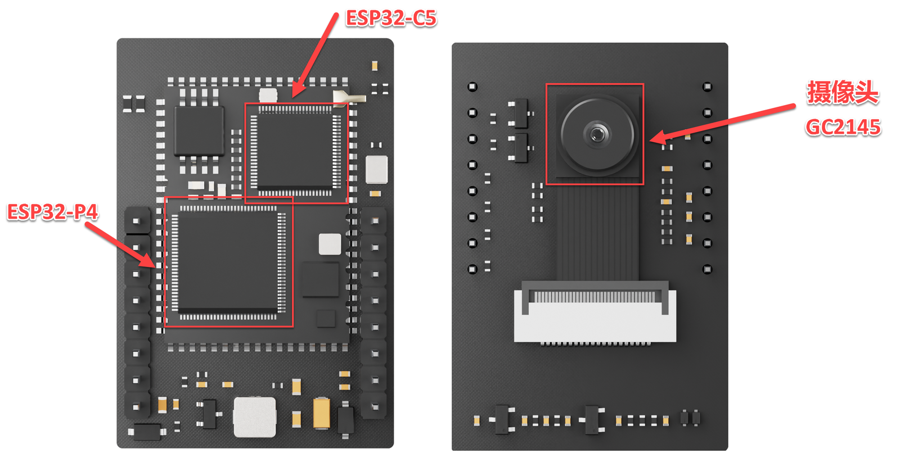
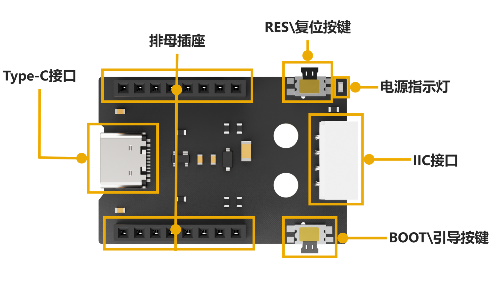
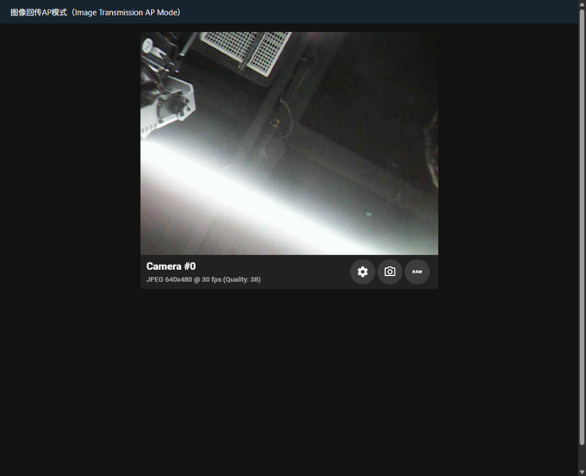

<div align="center">

# ESP32-P4C5-CAM



**Dual-Chip Edge AI Vision (`ESP32-P4`) & Dual-Band Wi-Fi 6 Streaming (`ESP32-C5`) Module**

[](https://github.com/HanerQAQ/ESP32-P4C5-CAM/actions/workflows/ci.yml)
[](https://docs.espressif.com/projects/esp-idf/en/v6.1/esp32p4/)
[](LICENSE)
[](examples/python_sdk/)

**English** | [简体中文](README_zh.md)

</div>

---

## 1. Overview & Product Line Comparison

**ESP32-P4C5-CAM** is a high-performance dual-chip edge AI camera module combining an **ESP32-P4** application SoC (dual-core RISC-V @ `400 MHz`, AI/DSP instructions, Hardware ISP, Hardware JPEG codec, 2D PPA) with an **ESP32-C5** wireless co-processor (RISC-V @ `240 MHz`, dual-band **2.4 GHz & 5 GHz Wi-Fi 6** + BLE 5.0 via SDIO), paired with a **GC2145 2MP 2-Lane MIPI-CSI** image sensor and a modular **Carrier Board**.

As the flagship **twin sibling** of [**ESP32-S3-CAM**](https://github.com/HanerQAQ/ESP32-S3-CAM), both repositories share a unified layout, a consistent `0xAA 0x55` 32-byte fragmented I²C protocol, cross-platform host SDKs (`Arduino`, `MicroPython`, `STM32 HAL`, `Raspberry Pi`, `Jetson Orin`), and the `ColorTool` HSV calibration desktop studio:

| Feature | [**ESP32-S3-CAM**](https://github.com/HanerQAQ/ESP32-S3-CAM) *(Twin Compact)* | **ESP32-P4C5-CAM** *(This Repo)* |
| :--- | :--- | :--- |
| **SoC Architecture** | ESP32-S3 Dual-Core LX7 @ 240 MHz | ESP32-P4 (Dual-Core RISC-V @ 400 MHz) + ESP32-C5 (RISC-V @ 240 MHz) |
| **Camera Interface** | Parallel DVP (`GC2145` 2MP) | 2-Lane MIPI-CSI (`GC2145` 2MP) + Hardware ISP / JPEG / PPA |
| **Wireless Connectivity** | 2.4 GHz Wi-Fi 4 (`802.11 b/g/n`) + BLE 5.0 | Dual-Band 2.4 & 5 GHz Wi-Fi 6 (`802.11ax`) + BLE 5.0 |
| **I²C Slave Address** | `0x52` (`SDA=GPIO47`, `SCL=GPIO48`) | `0x54` Offline AI / `0x52` Streaming (`SDA=GPIO46`, `SCL=GPIO47`) |
| **Firmware Applications** | **7** ESP-IDF v6.1 projects (Cat/Dog, Face Detect/Recognition, Color/Line, QR, AP/STA Stream) | **12** ESP-IDF v6.1 projects (YOLO11n 80-Class, 17-Keypoint Pose, Hand Gesture, AprilTag 6-DoF, Face, Cat, Dog, Pedestrian, Color/Line, QR, AP/STA Stream) |
| **Dimensions** | `42.0 × 27.0 × 19.0 mm` (Stacked Core + Carrier, `40 × 27 mm` PCB) | `42.0 × 27.0 × 19.0 mm` (Stacked Core + Carrier, `40 × 27 mm` PCB) |
| **Purchase Link (Taobao)** | [ESP32-S3-CAM Hardware Store](https://item.taobao.com/item.htm?id=791851247779) | [ESP32-P4C5-CAM Hardware Store](https://item.taobao.com/item.htm?id=1089874435189) |

---

## 2. Hardware Specifications & Interfaces

<div align="center">
  
</div>

| Component | Specification |
| :--- | :--- |
| **Application Processor** | ESP32-P4 Dual-Core RISC-V @ `400 MHz`, AI/DSP extensions, Hardware ISP, JPEG & PPA |
| **Wireless Co-Processor** | ESP32-C5 Single-Core RISC-V @ `240 MHz` via SDIO (2.4 & 5 GHz Wi-Fi 6 `802.11ax`, BLE 5.0) |
| **Camera Sensor** | `GC2145` 2MP CMOS sensor over 2-Lane MIPI-CSI (`24-Pin` 0.5 mm FPC, 24 MHz oscillator) |
| **Carrier USB & Debug** | USB Type-C wired to ESP32-P4 native USB (`D+/D-`) with ESD protection (`PRTR5V0U2X`) |
| **I²C Host Bus (`P1`)** | Keyed `5264-4P` connector: `Pin 1: VCC (5V)`, `Pin 2: GND`, `Pin 3: SDA (GPIO46)`, `Pin 4: SCL (GPIO47)` (`3.3V` TTL, `400 kHz`) |
| **Controls & Status** | `RST` hardware reset, `BOOT` (`GPIO35` active low, silkscreen `IO0`; 1s hold in STA firmware enters AP setup), `PWR1` 3.3V LED |
| **Power Requirements** | **`DC 5.0 V ≥ 2.0 A`** (shared `GND` with host controller mandatory for I²C signal integrity) |

- **Hardware Documentation**: [Hardware Guide (EN)](docs/hardware_guide_en.md) | [Schematics & Datasheets](hardware/README.md) | [Mechanical Dimensions SVG](hardware/mechanical_dimensions.svg) | [`SCH_ESP32P4C5-CAM_Module_V1.0.pdf`](hardware/SCH_ESP32P4C5-CAM_Module_V1.0.pdf) | [`SCH_ESP32P4C5-CAM_Carrier_Board.pdf`](hardware/SCH_ESP32P4C5-CAM_Carrier_Board.pdf)

---

## 3. Firmware Matrix (`ESP-IDF v6.1`)

All 12 source projects live in [`firmware/`](firmware/README.md) and compile into single `0x0`-offset merged binaries (see [`prebuilt_firmware/README.md`](prebuilt_firmware/README.md) and **[GitHub Releases](https://github.com/HanerQAQ/ESP32-P4C5-CAM/releases)**). Every offline vision firmware serves Web MJPEG previews over SoftAP `ESP32-P4C5-CAM-XXXXXX` (`http://192.168.5.1/`, port `81` stream) alongside the `0x54` I²C slave interface.

| Firmware Project | Vision / Streaming Capability | I²C `addr` | SoftAP & Web UI | Source |
| :--- | :--- | :---: | :--- | :--- |
| **`Image_transmission_function_STA`** | Dual-band STA + SoftAP provisioning Web MJPEG stream *(Factory Default)* | `0x52` | `ESP32-P4C5-CAM-XXXXXX` (`192.168.5.1/wifi`) | [`firmware/Image_transmission_function_STA`](firmware/Image_transmission_function_STA) |
| **`Image_transmission_function_AP`** | Default 2.4 GHz SoftAP MJPEG stream (5 GHz Wi-Fi 6 optional via `menuconfig`) + hardware self-test | `0x54` *(test)* | `ESP32-P4C5-CAM-XXXXXX` (`192.168.5.1`) | [`firmware/Image_transmission_function_AP`](firmware/Image_transmission_function_AP) |
| **`hand_gesture_recognition`** | 10-class hand gesture detection & classification (`ESP-DL`) | `0x54` | `ESP32-P4C5-CAM-XXXXXX` (`192.168.5.1`) | [`firmware/hand_gesture_recognition`](firmware/hand_gesture_recognition) |
| **`cat_detect`** | Offline cat detection | `0x54` | `ESP32-P4C5-CAM-XXXXXX` (`192.168.5.1`) | [`firmware/cat_detect`](firmware/cat_detect) |
| **`dog_detect`** | Offline dog detection | `0x54` | `ESP32-P4C5-CAM-XXXXXX` (`192.168.5.1`) | [`firmware/dog_detect`](firmware/dog_detect) |
| **`pedestrian_detect`** | Offline pedestrian bounding-box detection | `0x54` | `ESP32-P4C5-CAM-XXXXXX` (`192.168.5.1`) | [`firmware/pedestrian_detect`](firmware/pedestrian_detect) |
| **`coco_detect`** | YOLO11n 80-class object detection | `0x54` | `ESP32-P4C5-CAM-XXXXXX` (`192.168.5.1`) | [`firmware/coco_detect`](firmware/coco_detect) |
| **`human_face_detect`** | Real-time human face detection | `0x54` | `ESP32-P4C5-CAM-XXXXXX` (`192.168.5.1`) | [`firmware/human_face_detect`](firmware/human_face_detect) |
| **`coco_pose`** | 17-keypoint human body pose estimation | `0x54` | `ESP32-P4C5-CAM-XXXXXX` (`192.168.5.1`) | [`firmware/coco_pose`](firmware/coco_pose) |
| **`apriltag_recognition`** | AprilTag (`tag36h11`) detection & 6-DoF pose estimation | `0x54` | `ESP32-P4C5-CAM-XXXXXX` (`192.168.5.1`) | [`firmware/apriltag_recognition`](firmware/apriltag_recognition) |
| **`qrcode_recognition`** | Offline QR code localization & UTF-8 text decoding | `0x54` | `ESP32-P4C5-CAM-XXXXXX` (`192.168.5.1`) | [`firmware/qrcode_recognition`](firmware/qrcode_recognition) |
| **`color_detect`** | 5-channel HSV color blob detection & line tracking (`Flash` config) | `0x54` | `ESP32-P4C5-CAM-XXXXXX` (`192.168.5.1`) | [`firmware/color_detect`](firmware/color_detect) |

<details>
<summary>Preview: Live Web MJPEG Streaming UI (`192.168.5.1`)</summary>

<p align="center">
  
</p>

</details>

---

## 4. Quick Start

### 4.1 Build Firmware from Source (`ESP-IDF v6.1`)

Activate your **ESP-IDF v6.1** shell environment with the `riscv32-esp-elf` (`esp32p4`) toolchain installed, then build a single project or batch-export all 12 merged binaries:

```bash
# Batch build all 12 firmware projects & generate 0x0 merged binaries in prebuilt_firmware/
cd firmware
python build_and_verify_all.py --clean

# Or build & flash a single project directly:
cd hand_gesture_recognition
idf.py set-target esp32p4
idf.py build
idf.py -p COMx flash monitor
```

### 4.2 One-Click Flash Prebuilt Binaries (`0x0`)

Generate `0x0`-offset merged `.bin` images locally via `firmware/build_and_verify_all.py` (or download release assets from **[GitHub Releases](https://github.com/HanerQAQ/ESP32-P4C5-CAM/releases)** when published) into `prebuilt_firmware/`, then flash at offset `0x0`:

```bash
# Interactive launcher (Windows: flash.bat | Linux/macOS: ./flash.sh)
python tools/flash_firmware.py --port COMx --bin prebuilt_firmware/hand_gesture_recognition.bin --erase

# Or invoke esptool directly:
python -m esptool --chip esp32p4 -p COMx -b 921600 write-flash 0x0 prebuilt_firmware/hand_gesture_recognition.bin
```

### 4.3 Verify I²C Host Wiring (`0x54` / `0x52`)

```bash
# Dry-run protocol frame validation (no hardware required)
python tools/i2c_diagnose.py --mock

# Live Linux SBC / Raspberry Pi / Jetson probe (0x54 offline AI, or 0x52 streaming)
python tools/i2c_diagnose.py --bus 1 --addr 0x54
```

---

## 5. Multi-Platform Host SDKs & Examples

| Host Platform | Language / Framework | Driver Path | Demo Coverage | Guide |
| :--- | :--- | :--- | :---: | :--- |
| **Python SDK** *(Unified Core)* | Python 3.7+ (`smbus` / `ioctl`) | [`examples/python_sdk/`](examples/python_sdk/) | All 11 vision modes | [`examples/python_sdk/README.md`](examples/python_sdk/README.md) |
| **Raspberry Pi** | Python (`/dev/i2c-1`) | [`examples/raspberry_pi/`](examples/raspberry_pi/) | `01` ~ `11` | [`examples/raspberry_pi/README.md`](examples/raspberry_pi/README.md) |
| **NVIDIA Jetson Orin** | Python (`/dev/i2c-7`) | [`examples/jetson_orin/`](examples/jetson_orin/) | `01` ~ `11` | [`examples/jetson_orin/README.md`](examples/jetson_orin/README.md) |
| **ESP32 Arduino / PlatformIO** | C++ Library (`ESP32_P4C5_CAM`) | [`examples/esp32_arduino/`](examples/esp32_arduino/) | `01` ~ `11` | [`examples/esp32_arduino/README.md`](examples/esp32_arduino/README.md) |
| **ESP32 MicroPython** | MicroPython (`machine.I2C`) | [`examples/esp32_micropython/`](examples/esp32_micropython/) | `01` ~ `11` | [`examples/esp32_micropython/README.md`](examples/esp32_micropython/README.md) |
| **STM32 HAL** | C Driver + CMake Interface | [`examples/stm32_hal/`](examples/stm32_hal/) | `01` ~ `11` | [`examples/stm32_hal/README.md`](examples/stm32_hal/README.md) |

```python
from esp32_p4c5_cam import ESP32_P4C5_CAM, RawI2C

with RawI2C(bus=1) as bus:
    cam = ESP32_P4C5_CAM(bus)
    result = cam.get_hand_gesture_result()
    print(result)
```

---

## 6. ColorTool Desktop Studio (`tools/color_tool/`)

<div align="center">
  
</div>

A **PySide6 + OpenCV** calibration utility for `color_detect` firmware over the native ESP32-P4 USB Serial/JTAG Type-C port (driver-free CDC ACM, no external USB-UART bridge required): capture live camera frames, click pixels to sample HSV bounds (including red wrap-around), inspect real-time segmentation masks, manage JSON lighting presets, and save parameters permanently into Flash.

```bash
cd tools/color_tool
pip install -r requirements.txt
python main.py
```

---

## 7. Repository Structure

```text
ESP32-P4C5-CAM/
├── .github/
│   ├── ISSUE_TEMPLATE/             # Bug report & feature request templates
│   ├── PULL_REQUEST_TEMPLATE.md    # Pull request verification checklist
│   └── workflows/
│       ├── ci.yml                  # Python matrix tests, SDK/Arduino checks, links & PlatformIO build
│       └── release.yml             # Windows ColorTool executable packaging & GitHub Release
├── docs/
│   ├── assets/                     # Core/carrier renders, module overview & ColorTool screenshots
│   ├── hardware_guide_en.md        # Hardware specifications & carrier board guide (EN)
│   ├── hardware_guide_zh.md        # Hardware specifications & carrier board guide (ZH)
│   ├── i2c_protocol_en.md          # Complete 0x54/0x52 I2C protocol specification (EN)
│   ├── i2c_protocol_zh.md          # Complete 0x54/0x52 I2C protocol specification (ZH)
│   ├── uart_protocol_en.md         # ColorTool UART binary framing protocol (EN)
│   └── uart_protocol_zh.md         # ColorTool UART binary framing protocol (ZH)
├── examples/
│   ├── python_sdk/                 # Installable 'esp32-p4c5-cam' Python package
│   ├── raspberry_pi/               # Raspberry Pi /dev/i2c-1 demos (01 ~ 11)
│   ├── jetson_orin/                # NVIDIA Jetson Orin /dev/i2c-7 demos (01 ~ 11)
│   ├── esp32_arduino/              # Arduino 1.5 library ('ESP32_P4C5_CAM') + PlatformIO config
│   ├── esp32_micropython/          # MicroPython library & scripts (01 ~ 11)
│   └── stm32_hal/                  # Portable STM32 HAL C driver & CMake targets
├── firmware/
│   ├── components/                 # Shared ESP-IDF v6.1 components (bsp, who_web, coco_pose, etc.)
│   ├── Image_transmission_function_STA/
│   ├── Image_transmission_function_AP/
│   ├── hand_gesture_recognition/
│   ├── cat_detect/
│   ├── dog_detect/
│   ├── pedestrian_detect/
│   ├── coco_detect/
│   ├── human_face_detect/
│   ├── coco_pose/
│   ├── apriltag_recognition/
│   ├── qrcode_recognition/
│   ├── color_detect/
│   ├── build_and_verify_all.py     # Batch ESP-IDF v6.1 compiler & merge-bin exporter
│   └── clean_for_sharing.py        # Firmware build artifact cleaner
├── hardware/                       # Module & Carrier schematic PDFs, component datasheets & mechanical SVG
├── prebuilt_firmware/              # Staging directory & instructions for 0x0 merged binaries
├── tests/                          # Automated unit tests (driver, tools, firmware & hygiene)
├── tools/
│   ├── color_tool/                 # PySide6 HSV threshold tuning studio
│   ├── clean_repo.py               # Python cache & artifact cleaner
│   ├── flash_firmware.py           # Cross-platform esptool wrapper
│   └── i2c_diagnose.py             # I2C bus & frame integrity diagnostic CLI
├── CODE_OF_CONDUCT.md
├── CONTRIBUTING.md
├── LICENSE                         # MIT License (Copyright (c) 2026 HanerQAQ)
├── NOTICE
└── SECURITY.md
```

---

## 8. Documentation Index

- **Protocol Specifications**: [I²C Vision Protocol (EN)](docs/i2c_protocol_en.md) | [I²C 视觉协议 (中文)](docs/i2c_protocol_zh.md) | [UART Calibration Protocol (EN)](docs/uart_protocol_en.md) | [串口调参协议 (中文)](docs/uart_protocol_zh.md)
- **Hardware & Schematics**: [Hardware Guide (EN)](docs/hardware_guide_en.md) | [硬件规格与接口说明 (中文)](docs/hardware_guide_zh.md) | [Schematics & Datasheets](hardware/README.md)
- **Firmware & Tools**: [Firmware Guide](firmware/README.md) | [Prebuilt Firmware Guide](prebuilt_firmware/README.md) | [Developer Tools](tools/README.md) | [Unit Tests](tests/README.md)

---

## 9. Contributing & License

- **Contributions**: Please read [`CONTRIBUTING.md`](CONTRIBUTING.md), [`CODE_OF_CONDUCT.md`](CODE_OF_CONDUCT.md), and [`SECURITY.md`](SECURITY.md) before opening issues or pull requests.
- **License**: Released under the **[MIT License](LICENSE)** (`Copyright (c) 2026 HanerQAQ`). See [`NOTICE`](NOTICE) for bundled open-source third-party component attributions.
