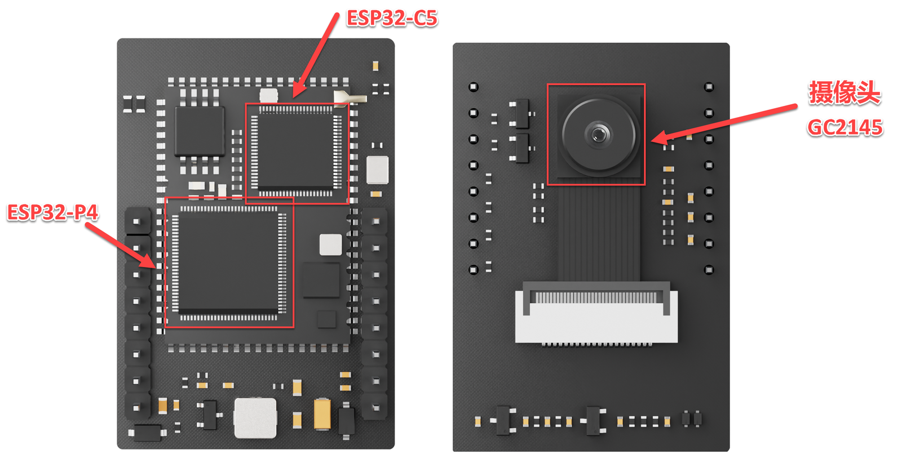
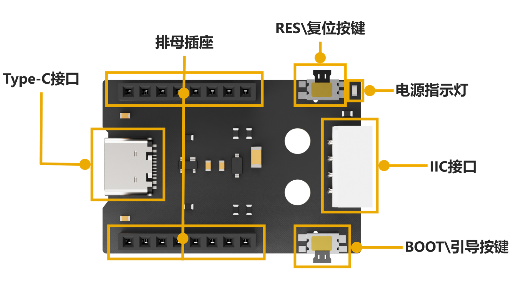
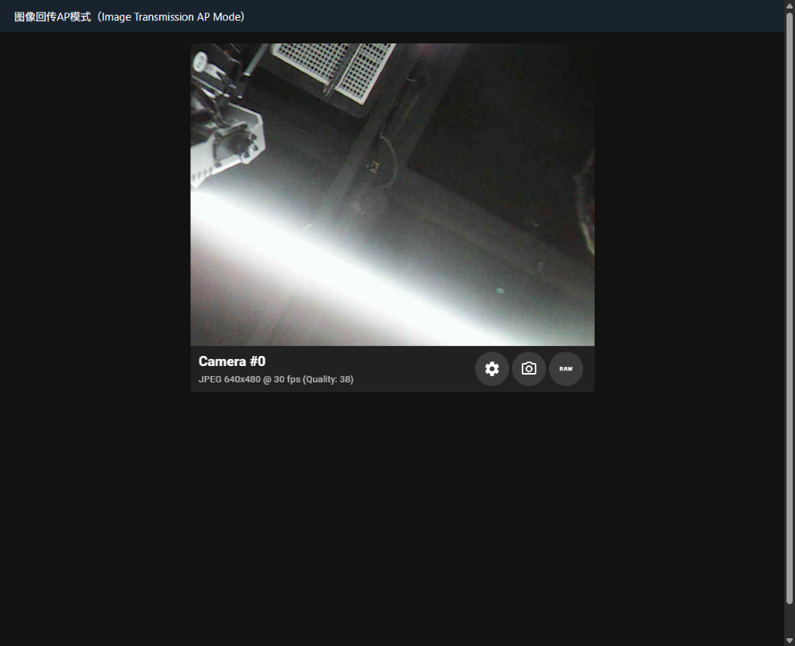

<div align="center">

# ESP32-P4C5-CAM



**双芯端侧 AI 视觉算力（`ESP32-P4`）+ 双频 Wi-Fi 6 图传（`ESP32-C5`）旗舰模组**

[](https://github.com/HanerQAQ/ESP32-P4C5-CAM/actions/workflows/ci.yml)
[](https://docs.espressif.com/projects/esp-idf/en/v6.1/esp32p4/)
[](LICENSE)
[](examples/python_sdk/)

[English](README.md) | **简体中文**

</div>

---

## 1. 产品概述与双系列对比

**ESP32-P4C5-CAM** 是一款高性能“主控算力 + 无线协处理器”双芯架构的边缘 AI 视觉模组。模组结合 **ESP32-P4** 应用处理器（双核 RISC-V @ `400 MHz`、AI/DSP 扩展指令、硬件 ISP、硬件 JPEG 编解码及 2D PPA 加速）与 **ESP32-C5** 无线协处理器（RISC-V @ `240 MHz`、SDIO 挂载双频 **2.4 GHz & 5 GHz Wi-Fi 6** 与 BLE 5.0），标配 **GC2145 200 万像素 2-Lane MIPI-CSI** 摄像头及模块化**扩展底板 (Carrier Board)**。

作为与 [**ESP32-S3-CAM**](https://github.com/HanerQAQ/ESP32-S3-CAM) 一脉相承的**孪生系列**产品，两套仓库采用统一的目录规范、`0xAA 0x55` 32 字节分片 I²C 视觉协议、全平台主控 SDK（`Arduino`、`MicroPython`、`STM32 HAL`、`Raspberry Pi`、`Jetson Orin`）以及 `ColorTool` HSV 颜色阈值上位机调参工具：

| 对比维度 | [**ESP32-S3-CAM**](https://github.com/HanerQAQ/ESP32-S3-CAM) *(孪生紧凑版)* | **ESP32-P4C5-CAM** *(本仓库)* |
| :--- | :--- | :--- |
| **主控芯片架构** | ESP32-S3 双核 LX7 @ 240 MHz | ESP32-P4（双核 RISC-V @ 400 MHz）+ ESP32-C5（RISC-V @ 240 MHz） |
| **摄像头总线与ISP** | 并行 DVP 接口（`GC2145` 2MP） | 2-Lane MIPI-CSI（`GC2145` 2MP）+ 硬件 ISP / JPEG / PPA |
| **无线通信能力** | 2.4 GHz Wi-Fi 4（`802.11 b/g/n`）+ BLE 5.0 | 2.4 & 5 GHz 双频 Wi-Fi 6（`802.11ax`）+ BLE 5.0 |
| **I²C 从机地址与引脚** | `0x52`（`SDA=GPIO47`, `SCL=GPIO48`） | `0x54` 离线视觉 / `0x52` 无线图传（`SDA=GPIO46`, `SCL=GPIO47`） |
| **配套固件工程** | **7 套** ESP-IDF v6.1 工程（猫狗检测、人脸检测/识别、颜色与巡线、二维码、AP/STA 图传） | **12 套** ESP-IDF v6.1 工程（YOLO11n 80 类、17 关键点姿态、手势识别、AprilTag 6-DoF、人脸、猫/狗/行人、颜色巡线、二维码、AP/STA 图传） |
| **结构形态** | `42.0 × 27.0 × 19.0 mm`（核心板 + 扩展底板堆叠，`40 × 27 mm` PCB） | `42.0 × 27.0 × 19.0 mm`（核心板 + 扩展底板堆叠，`40 × 27 mm` PCB） |
| **硬件购买链接（淘宝）** | [ESP32-S3-CAM 购买链接](https://item.taobao.com/item.htm?id=791851247779) | [ESP32-P4C5-CAM 购买链接](https://item.taobao.com/item.htm?id=1089874435189) |

---

## 2. 硬件规格与接口定义

<div align="center">
  
</div>

| 硬件单元 | 规格参数说明 |
| :--- | :--- |
| **应用计算处理器** | ESP32-P4 双核 RISC-V @ `400 MHz`，支持 AI/DSP 指令扩展、硬件 ISP、JPEG 与 PPA |
| **无线通信协处理器** | ESP32-C5 单核 RISC-V @ `240 MHz`（SDIO 通信，2.4 & 5 GHz Wi-Fi 6 `802.11ax`、BLE 5.0） |
| **图像传感器** | `GC2145` 200 万像素 CMOS，2-Lane MIPI-CSI（`24-Pin` 0.5 mm FPC 接口，板载 24 MHz 晶振） |
| **底板 USB 调试口** | USB Type-C 接口，直连 ESP32-P4 原生 USB（`D+/D-`），内置 ESD 静电保护（`PRTR5V0U2X`） |
| **I²C 通信端子 (`P1`)** | `5264-4P` 防呆端子：`Pin 1: VCC (5V)`、`Pin 2: GND`、`Pin 3: SDA (GPIO46)`、`Pin 4: SCL (GPIO47)`（`3.3V` 电平，`400 kHz`） |
| **按键与指示灯** | `RST` 硬件复位键、`BOOT`（`GPIO35` 低电平有效，丝印 `IO0`；STA 固件下长按 1 秒重新配网）、`PWR1` 3.3V 电源灯 |
| **供电要求** | **`DC 5.0 V ≥ 2.0 A`**；I²C 通信时**必须与外部主控共地 (`GND`)** |

- **硬件资料文档**：[硬件规格与接口说明](docs/hardware_guide_zh.md) | [原理图与数据手册索引](hardware/README.md) | [结构尺寸图 SVG](hardware/mechanical_dimensions.svg) | [`SCH_ESP32P4C5-CAM_Module_V1.0.pdf`](hardware/SCH_ESP32P4C5-CAM_Module_V1.0.pdf) | [`SCH_ESP32P4C5-CAM_Carrier_Board.pdf`](hardware/SCH_ESP32P4C5-CAM_Carrier_Board.pdf)

---

## 3. 固件工程矩阵（`ESP-IDF v6.1`）

全部 12 套源码工程位于 [`firmware/`](firmware/README.md)，均基于 **ESP-IDF v6.1** 构建，可通过 `idf.py merge-bin` 导出为从 `0x0` 起始烧录的单文件固件（参见 [`prebuilt_firmware/README.md`](prebuilt_firmware/README.md) 与 **[GitHub Releases](https://github.com/HanerQAQ/ESP32-P4C5-CAM/releases)**）。所有离线视觉固件均开启 Web 实时推理图传（SoftAP `ESP32-P4C5-CAM-XXXXXX`，`http://192.168.5.1/`）及 `0x54` I²C 从机输出。

| 固件工程目录 | 功能说明 | I²C 地址 | 默认热点与 Web 地址 | 源码入口 |
| :--- | :--- | :---: | :--- | :--- |
| **`Image_transmission_function_STA`** | 双频 STA + SoftAP 网页配网图传 *(出厂默认)* | `0x52` | `ESP32-P4C5-CAM-XXXXXX`（`192.168.5.1/wifi`） | [`firmware/Image_transmission_function_STA`](firmware/Image_transmission_function_STA) |
| **`Image_transmission_function_AP`** | 默认 2.4 GHz SoftAP 实时图传（可在 `menuconfig` 切换为 5 GHz Wi-Fi 6）与硬件自检 | `0x54` *(测试)* | `ESP32-P4C5-CAM-XXXXXX`（`192.168.5.1`） | [`firmware/Image_transmission_function_AP`](firmware/Image_transmission_function_AP) |
| **`hand_gesture_recognition`** | 10 种常见手势识别与分类（`ESP-DL`） | `0x54` | `ESP32-P4C5-CAM-XXXXXX`（`192.168.5.1`） | [`firmware/hand_gesture_recognition`](firmware/hand_gesture_recognition) |
| **`cat_detect`** | 离线猫咪目标检测 | `0x54` | `ESP32-P4C5-CAM-XXXXXX`（`192.168.5.1`） | [`firmware/cat_detect`](firmware/cat_detect) |
| **`dog_detect`** | 离线狗狗目标检测 | `0x54` | `ESP32-P4C5-CAM-XXXXXX`（`192.168.5.1`） | [`firmware/dog_detect`](firmware/dog_detect) |
| **`pedestrian_detect`** | 离线行人目标检测 | `0x54` | `ESP32-P4C5-CAM-XXXXXX`（`192.168.5.1`） | [`firmware/pedestrian_detect`](firmware/pedestrian_detect) |
| **`coco_detect`** | YOLO11n 80 类通用目标检测 | `0x54` | `ESP32-P4C5-CAM-XXXXXX`（`192.168.5.1`） | [`firmware/coco_detect`](firmware/coco_detect) |
| **`human_face_detect`** | 实时人脸框检测 | `0x54` | `ESP32-P4C5-CAM-XXXXXX`（`192.168.5.1`） | [`firmware/human_face_detect`](firmware/human_face_detect) |
| **`coco_pose`** | 17 关键点人体骨骼姿态估计 | `0x54` | `ESP32-P4C5-CAM-XXXXXX`（`192.168.5.1`） | [`firmware/coco_pose`](firmware/coco_pose) |
| **`apriltag_recognition`** | AprilTag（`tag36h11`）识别与 6-DoF 位姿解算 | `0x54` | `ESP32-P4C5-CAM-XXXXXX`（`192.168.5.1`） | [`firmware/apriltag_recognition`](firmware/apriltag_recognition) |
| **`qrcode_recognition`** | 离线二维码定位与 UTF-8 文本解码 | `0x54` | `ESP32-P4C5-CAM-XXXXXX`（`192.168.5.1`） | [`firmware/qrcode_recognition`](firmware/qrcode_recognition) |
| **`color_detect`** | 5 组色块识别与视觉巡线（阈值写入 Flash 掉电保存） | `0x54` | `ESP32-P4C5-CAM-XXXXXX`（`192.168.5.1`） | [`firmware/color_detect`](firmware/color_detect) |

<details>
<summary>界面预览：Web 实时图传页面（<code>192.168.5.1</code>）</summary>

<p align="center">
  
</p>

</details>

---

## 4. 快速开始

### 4.1 从源码编译（`ESP-IDF v6.1`）

激活 **ESP-IDF v6.1** 命令行环境（需包含 `riscv32-esp-elf` 工具链以支持 `esp32p4` 目标），即可单工程编译或一键批量编译全部 12 个工程：

```bash
# 一键批量编译全部 12 个工程并导出 0x0 合并固件至 prebuilt_firmware/
cd firmware
python build_and_verify_all.py --clean

# 或进入单个工程独立编译与烧录：
cd hand_gesture_recognition
idf.py set-target esp32p4
idf.py build
idf.py -p COMx flash monitor
```

### 4.2 一键烧录合并固件（`0x0`）

通过 `firmware/build_and_verify_all.py` 本地生成 `0x0` 合并固件（或待发布后从 **[GitHub Releases](https://github.com/HanerQAQ/ESP32-P4C5-CAM/releases)** 下载）放入 `prebuilt_firmware/` 后，从 `0x0` 地址烧录：

```bash
# 使用跨平台交互烧录工具（Windows 可双击 flash.bat，Linux/macOS 可运行 ./flash.sh）
python tools/flash_firmware.py --port COMx --bin prebuilt_firmware/hand_gesture_recognition.bin --erase

# 或直接使用 esptool：
python -m esptool --chip esp32p4 -p COMx -b 921600 write-flash 0x0 prebuilt_firmware/hand_gesture_recognition.bin
```

### 4.3 I²C 通信连通性诊断（`0x54` / `0x52`）

```bash
# 无硬件模拟帧校验测试
python tools/i2c_diagnose.py --mock

# 树莓派 / Jetson Linux 总线实测探针（离线视觉 0x54，无线图传 0x52）
python tools/i2c_diagnose.py --bus 1 --addr 0x54
```

---

## 5. 全平台主控 SDK 与通信例程

| 主控平台 | 语言 / 框架 | 驱动目录 | 配套例程数 | 文档入口 |
| :--- | :--- | :--- | :---: | :--- |
| **Python SDK** *(通用核心)* | Python 3.7+（`smbus` / `ioctl`） | [`examples/python_sdk/`](examples/python_sdk/) | 全 11 项离线视觉协议 | [`examples/python_sdk/README.md`](examples/python_sdk/README.md) |
| **Raspberry Pi** | Python（`/dev/i2c-1`） | [`examples/raspberry_pi/`](examples/raspberry_pi/) | `01` ~ `11` | [`examples/raspberry_pi/README.md`](examples/raspberry_pi/README.md) |
| **NVIDIA Jetson Orin** | Python（`/dev/i2c-7`） | [`examples/jetson_orin/`](examples/jetson_orin/) | `01` ~ `11` | [`examples/jetson_orin/README.md`](examples/jetson_orin/README.md) |
| **ESP32 Arduino / PlatformIO** | C++ 库（`ESP32_P4C5_CAM`） | [`examples/esp32_arduino/`](examples/esp32_arduino/) | `01` ~ `11` | [`examples/esp32_arduino/README.md`](examples/esp32_arduino/README.md) |
| **ESP32 MicroPython** | MicroPython（`machine.I2C`） | [`examples/esp32_micropython/`](examples/esp32_micropython/) | `01` ~ `11` | [`examples/esp32_micropython/README.md`](examples/esp32_micropython/README.md) |
| **STM32 HAL** | C 驱动与 CMake 接口库 | [`examples/stm32_hal/`](examples/stm32_hal/) | `01` ~ `11` | [`examples/stm32_hal/README.md`](examples/stm32_hal/README.md) |

```python
from esp32_p4c5_cam import ESP32_P4C5_CAM, RawI2C

with RawI2C(bus=1) as bus:
    cam = ESP32_P4C5_CAM(bus)
    result = cam.get_hand_gesture_result()
    print(result)
```

---

## 6. ColorTool 颜色阈值调参上位机（`tools/color_tool/`）

<div align="center">
  
</div>

基于 **PySide6 + OpenCV** 开发的桌面端可视化调参软件，配合 `color_detect` 固件通过底板 Type-C 原生 ESP32-P4 USB Serial/JTAG 接口（免外置 CH340 驱动）在线抓图、鼠标点击取色（支持红色色相跨区间自动处理）、实时预览二值化 Mask、导入/导出 JSON 光照预设，并一键写入模块 Flash 掉电保存。

```bash
cd tools/color_tool
pip install -r requirements.txt
python main.py
```

---

## 7. 仓库目录结构

```text
ESP32-P4C5-CAM/
├── .github/
│   ├── ISSUE_TEMPLATE/             # Issue 问题反馈与功能建议模板
│   ├── PULL_REQUEST_TEMPLATE.md    # Pull Request 提交检查清单
│   └── workflows/
│       ├── ci.yml                  # Python 多版本单测、SDK/Arduino 规范、死链与 PlatformIO 检查
│       └── release.yml             # Windows 版 ColorTool 自动打包与 Release 发布
├── docs/
│   ├── assets/                     # 核心板/底板渲染图、模块概览与 ColorTool 截图
│   ├── hardware_guide_en.md        # 硬件规格与扩展底板说明（英文）
│   ├── hardware_guide_zh.md        # 硬件规格与扩展底板说明（中文）
│   ├── i2c_protocol_en.md          # 0x54/0x52 I2C 视觉协议规范（英文）
│   ├── i2c_protocol_zh.md          # 0x54/0x52 I2C 视觉协议规范（中文）
│   ├── uart_protocol_en.md         # ColorTool 串口调参协议（英文）
│   └── uart_protocol_zh.md         # ColorTool 串口调参协议（中文）
├── examples/
│   ├── python_sdk/                 # 可安装包 'esp32-p4c5-cam' Python SDK
│   ├── raspberry_pi/               # 树莓派 /dev/i2c-1 例程 (01 ~ 11)
│   ├── jetson_orin/                # NVIDIA Jetson Orin /dev/i2c-7 例程 (01 ~ 11)
│   ├── esp32_arduino/              # Arduino 1.5 规范库 ('ESP32_P4C5_CAM') 与 PlatformIO 配置
│   ├── esp32_micropython/          # MicroPython 驱动库与示例 (01 ~ 11)
│   └── stm32_hal/                  # STM32 HAL C 语言驱动与 CMake 构建支持
├── firmware/
│   ├── components/                 # ESP-IDF v6.1 共享组件（bsp、who_web、coco_pose 等）
│   ├── Image_transmission_function_STA/
│   ├── Image_transmission_function_AP/
│   ├── hand_gesture_recognition/
│   ├── cat_detect/
│   ├── dog_detect/
│   ├── pedestrian_detect/
│   ├── coco_detect/
│   ├── human_face_detect/
│   ├── coco_pose/
│   ├── apriltag_recognition/
│   ├── qrcode_recognition/
│   ├── color_detect/
│   ├── build_and_verify_all.py     # ESP-IDF v6.1 一键批量编译与导出工具
│   └── clean_for_sharing.py        # 固件构建产物清理脚本
├── hardware/                       # 核心板/扩展底板原理图 PDF、芯片数据手册与结构尺寸图 SVG
├── prebuilt_firmware/              # 0x0 一体化合并固件存放目录与烧录指南
├── tests/                          # 自动化单元测试（驱动、工具、工程完整性与仓库规范）
├── tools/
│   ├── color_tool/                 # PySide6 HSV 阈值调节上位机
│   ├── clean_repo.py               # Python 缓存与构建残留清理脚本
│   ├── flash_firmware.py           # 跨平台 esptool 一键烧录工具
│   └── i2c_diagnose.py             # I2C 总线与帧协议连通性诊断脚本
├── CODE_OF_CONDUCT.md
├── CONTRIBUTING.md
├── LICENSE                         # MIT 开源许可证 (Copyright (c) 2026 HanerQAQ)
├── NOTICE
└── SECURITY.md
```

---

## 8. 文档索引

- **通信协议规范**：[I²C 视觉协议（中文）](docs/i2c_protocol_zh.md) | [I²C Vision Protocol (EN)](docs/i2c_protocol_en.md) | [串口调参协议（中文）](docs/uart_protocol_zh.md) | [UART Protocol (EN)](docs/uart_protocol_en.md)
- **硬件与结构资料**：[硬件规格与接口说明（中文）](docs/hardware_guide_zh.md) | [Hardware Guide (EN)](docs/hardware_guide_en.md) | [原理图与数据手册索引](hardware/README.md)
- **固件、工具与测试**：[固件源码指南](firmware/README.md) | [预编译固件指南](prebuilt_firmware/README.md) | [开发者工具套件](tools/README.md) | [自动化测试套件](tests/README.md)

---

## 9. 参与贡献与开源协议

- **社区贡献**：提交 Issue 或 Pull Request 前，请参阅 [`CONTRIBUTING.md`](CONTRIBUTING.md)、[`CODE_OF_CONDUCT.md`](CODE_OF_CONDUCT.md) 与 [`SECURITY.md`](SECURITY.md)。
- **开源许可**：本项目基于 **[MIT License](LICENSE)** 开源（`Copyright (c) 2026 HanerQAQ`）。所含第三方开源组件版权声明请参阅 [`NOTICE`](NOTICE)。
