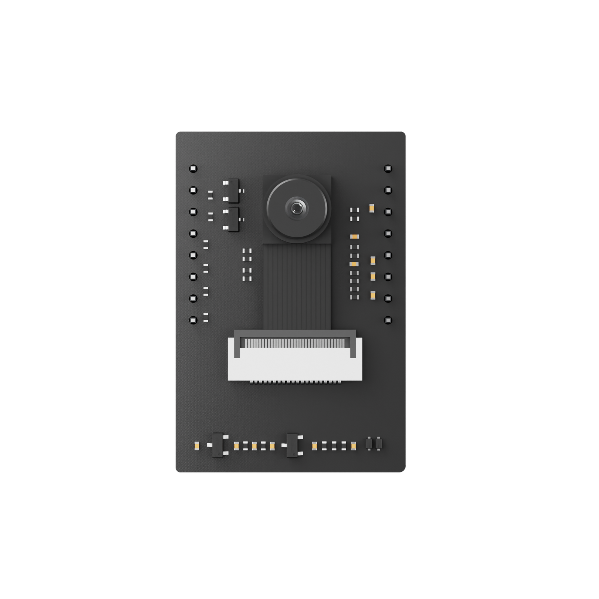
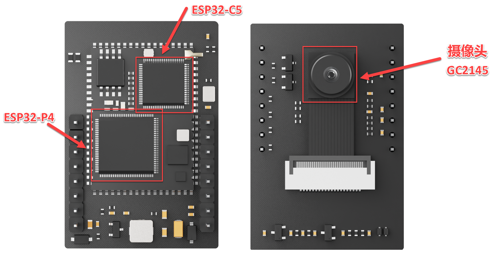
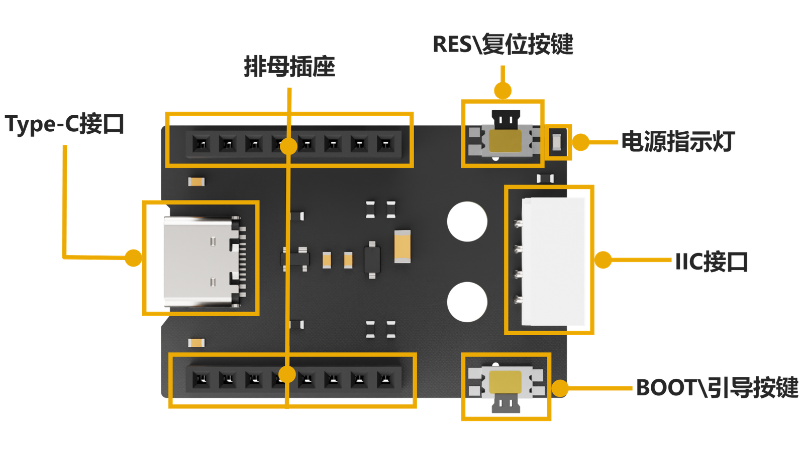

# Hardware Overview (ESP32P4C5-Cam)

**English** | [简体中文](hardware_guide_zh.md)

---

## 1. Introduction

**ESP32P4C5-Cam** is a high-performance dual-chip AI camera module designed for edge computer vision, embodied AI, and low-latency wireless video streaming. It consists of the **ESP32P4C5-CAM Mini Core Board** and the **P4C5-CAM Carrier Board**, allowing it to be embedded directly as a compact minimum system or rapidly evaluated via the carrier board.

- **Compute & Vision Processing (ESP32-P4)**: Dual-core RISC-V @ 400 MHz with AI/DSP instruction extensions, hardware ISP, hardware JPEG codec, and 2D PPA accelerator dedicated to MIPI image capture and on-device vision inference.
- **High-Speed Wireless (ESP32-C5)**: Single-core RISC-V @ 240 MHz supporting dual-band **2.4 GHz & 5 GHz Wi-Fi 6 (802.11ax)** and **Bluetooth 5.0 (LE)** for low-latency video streaming and telemetry.
- **High Integration**: Combines compute, dual-band RF antenna, and a 2MP MIPI-CSI camera in a compact form factor.

---

## 2. Key Features

| Category | Feature | Hardware Implementation |
| :--- | :--- | :--- |
| **Dual-Chip Architecture** | **ESP32-P4 + ESP32-C5** | P4 (up to 400 MHz) handles camera capture and AI inference; C5 independently handles dual-band Wi-Fi 6 / BLE communication without contending for compute resources. |
| **Camera Interface** | **2-Lane MIPI-CSI** | Onboard 24-Pin FPC (0.5 mm pitch) MIPI connector paired with a **GC2145 (2MP)** sensor for higher image quality and frame rate than legacy parallel DVP. |

---

## 3. Technical Specifications

| Dimension | Parameter | Specification |
| :--- | :--- | :--- |
| **Processors** | **Application MCU** | ESP32-P4 (Dual-core RISC-V @ 400 MHz, AI/DSP extensions) |
| | **Wireless Co-Processor** | ESP32-C5 (Single-core RISC-V @ 240 MHz, dual-band RF baseband) |
| **Power Supply** | **Input Voltage** | DC 5V (via carrier Type-C or 5V header, `4.75V ~ 5.25V`) |
| | **Main Buck Regulator** | MT2492 synchronous buck DC-DC (`VDD33` system rail) |
| | **Camera LDOs** | `U9`: RT9166A-18GVL (`VDD18`); `U10`: RT9166A-28GVL (`VDD28` analog) |
| **Vision Input** | **Connector** | 24-Pin 0.5 mm pitch FPC flip-lock connector (`CAM1`) |
| | **Bus** | 2-Lane MIPI-CSI (`CSI_D0P/N`, `CSI_D1P/N`, `CSI_CLKP/N`) |
| | **Image Sensor** | GC2145 (2MP CMOS sensor) |
| | **External Clock** | Onboard 24 MHz active crystal `Y2` (2520) supplying `CAM2_MCLK` |
| **Wireless** | **Wi-Fi** | IEEE 802.11ax/b/g/n (Wi-Fi 6, 2.4 GHz & 5 GHz dual-band) |
| | **Bluetooth** | Bluetooth 5.0 (LE) + Bluetooth Mesh |
| | **Antenna** | Onboard high-gain PCB RF antenna |
| **Interfaces** | **Data & Expansion** | 1× USB 2.0 Full-Speed (`D+/D-`), 2× UART (`U0TXD/RXD`, C5 debug UART), 2× I²C |
| | **Carrier Connectors** | USB Type-C (power & data), `5264-4P` keyed I²C header (with MT9700 protection) |
| **Environment** | **Operating Temp / Humidity** | -20℃ ~ 70℃ / < 90% RH (non-condensing) |
| | **Storage** | -40℃ ~ 125℃ / < 90% RH |

---

## 4. Carrier Board Interfaces

| Interface | Designator | Description |
| :--- | :--- | :--- |
| **USB Type-C** | `USB-C1` | 5V DC power input with CC1/CC2 pull-down resistors, wired to ESP32-P4 native USB (`D+/D-`) with ESD protection (`D3`: PRTR5V0U2X). |
| **I²C Header** | `P1 (5264-4P)` | Keyed 4-Pin connector (`Pin 1: VCC`, `Pin 2: GND`, `Pin 3: SDA`, `Pin 4: SCL`). |
| **Pin Headers** | `U5` | 2×8P female headers for mounting the P4C5-CAM Mini core module. |
| **Reset Button** | `RST` | Hardware reset button pulling `P4_EN` / `C5_EN` low to reboot the system. |
| **Boot Button** | `IO0` | Multi-function button: hold with reset to enter download mode; usable as user input at runtime. |
| **Power LED** | `PWR1` | Red LED, illuminates when the 3.3V rail is active. |

---

## 5. Notes

1. Provide a stable **5V ≥ 2A** power supply; insufficient current may cause horizontal ripple artifacts in images.
2. Modules ship with the wireless image-streaming factory firmware by default. Flash the corresponding ESP-IDF vision firmware for offline AI recognition tasks.

---

## 6. Schematics & Hardware References

For detailed module pinouts, circuit schematic PDFs, and component datasheets (ESP32-P4, ESP32-C5, GC2145), see:
- [Hardware Documentation & Schematic Index (hardware/README.md)](../hardware/README.md)
