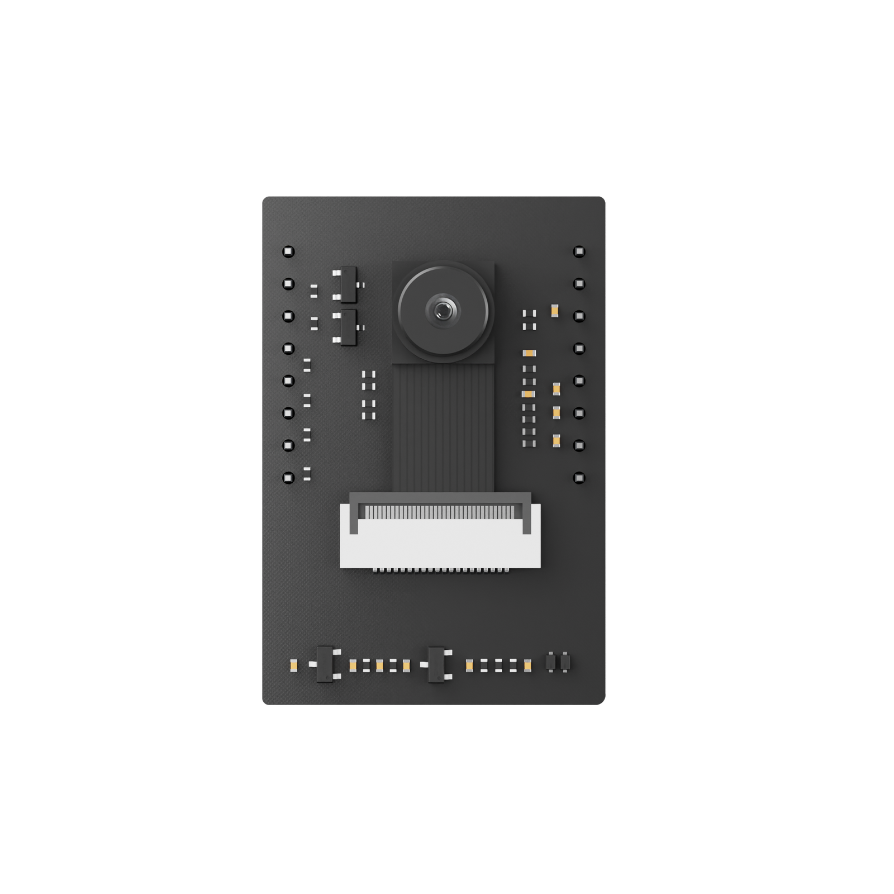
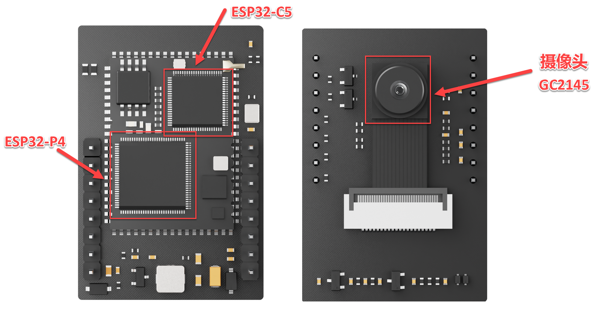
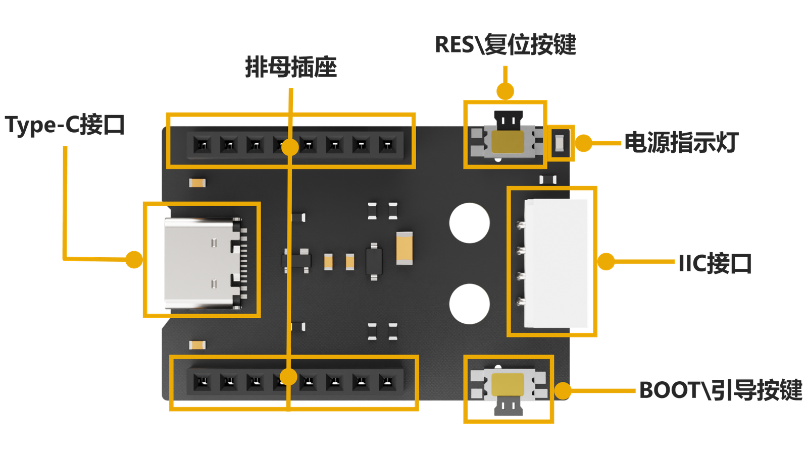

# ESP32P4C5-Cam 硬件规格与接口说明

[English](hardware_guide_en.md) | **简体中文**

---

## 1. 产品简介

**P4C5 Cam 高性能双芯 AI 视觉模块**

**P4C5-CAM** 是一款面向边缘 AI 机器视觉、具身智能与高清低延迟图传的高性能双芯摄像头模组。模块由 **ESP32P4C5-CAM Mini 核心板** 与 **P4C5-CAM Carrier Board 扩展底板** 组合而成，既可作为紧凑型最小系统独立嵌入部署，也可配合底板快速调试。

模块创新性地采用“主控算力 + 无线协处理器”双芯分工架构：

- **核心算力与图像处理**：依托 ESP32-P4 的多核处理性能与硬件级多媒体扩展能力，支持流畅的高清图像采集、硬件编解码及端侧轻量化 AI 算法部署（如人脸识别、物体检测、手势识别）。搭载 400 MHz 高性能双核 RISC-V 处理器，集成硬件 ISP、硬件 JPEG 编解码器与 2D 图形加速引擎（PPA），专责 MIPI 视频流实时采集与端侧 AI 视觉算法推理。
- **高速无线通信**：集成 ESP32-C5 芯片，提供双频 Wi-Fi 6 低延迟、高吞吐传输，保障高清图传、视频流推送以及设备与云端交互的高稳定性与低功耗表现。原生支持 2.4 GHz & 5 GHz 双频 Wi-Fi 6（802.11ax）与 Bluetooth 5.0 (LE)，负责高速图传、低延迟控制流与云端互联通信。
- **高集成度与即开即用**：集主控、无线天线及光学摄像头于一体，接口丰富，易于二次开发与系统集成。

广泛适用于教育机器人视觉套件、工业条码/色块识别、机械臂末端识别、全屋智能门禁视觉等边缘计算场景。

---

## 2. 核心特性

| **分类**           | **核心特性**             | **原理图设计与硬件实现说明**                                 |
| ------------------ | ------------------------ | ------------------------------------------------------------ |
| **双芯协同架构**    | **ESP32-P4 + ESP32-C5**  | P4 主频最高 400 MHz 负责图像采集与 AI 推理；C5 独立负责双频高速通信，算力与通信解耦互不抢占资源。 |
| **高清摄像头接入**  | **2-Lane MIPI-CSI 接口** | 原生板载 **24-Pin FPC (0.5mm 间距) MIPI 接口**，标配 **GC2145 (200万像素)** 传感器，画质与帧率远超传统并行 DVP。 |

---

## 3. 技术规格参数

| **维度**     | **参数项**          | **硬件规格说明**                                             |
| ------------ | ------------------- | ------------------------------------------------------------ |
| **主控核心** | **应用计算处理器**  | ESP32-P4（高算力双核 RISC-V @ 400 MHz，支持 AI/DSP 指令扩展） |
|              | **通信协处理器**    | ESP32-C5（单核 RISC-V @ 240 MHz，集成双频无线射频基带）      |
| **供电系统** | **输入工作电压**    | DC 5V（通过底板 Type-C 或排针 5V 接口供电，范围 4.75V ~ 5.25V） |
|              | **板载主降压**      | MT2492 同步降压 DC-DC（输出稳定 VDD33 系统电源）             |
|              | **摄像头专属 LDO**  | U9: RT9166A-18GVL（输出 VDD18）；U10: RT9166A-28GVL（输出 VDD28 模拟电） |
| **视觉输入** | **接口形式**        | 24-Pin 0.5mm 间距 FPC 翻盖式接口（CAM1）                     |
|              | **总线接口**        | 2-Lane MIPI-CSI（CSI_D0P/N、CSI_D1P/N、CSI_CLKP/N）          |
|              | **标配图像传感器**  | GC2145（200 万像素高清传感器）                               |
|              | **摄像头外部时钟**  | 板载 24MHz 有源晶振 Y2（2520 封装）提供 CAM2_MCLK            |
| **无线通信** | **Wi-Fi 标准**      | IEEE 802.11ax/b/g/n（Wi-Fi 6，支持 2.4 GHz 与 5 GHz 双频并发） |
|              | **蓝牙规格**        | Bluetooth 5.0 (LE) + Bluetooth Mesh                          |
|              | **天线形态**        | 板载高增益 PCB 射频天线                                      |
| **扩展接口** | **通信与数据接口**  | 1 路 USB 2.0 Full-Speed（D+/D-）、2 路硬件 UART（U0TXD/RXD、C5 调试串口）、2 路 I2C 总线 |
|              | **外设底板接口**    | Type-C 接口（供电与数据）、5264-4P 机器视觉专属防呆端子（含 MT9700 保护） |
| **操作环境** | **工作温度 / 湿度** | -20℃ ~ 70℃ / < 90% RH (无凝结)                               |
|              | **存储环境**        | -40℃ ~ 125℃ / < 90% RH                                       |

---

## 4. Carrier Board 扩展底板接口说明

底板提供了即插即用的调试环境与面向机器人的抗干扰接口：

| **接口名称**       | **元件位号**   | **电路特性与功能说明**                                       |
| ------------------ | -------------- | ------------------------------------------------------------ |
| **Type-C 接口**    | `USB-C1`       | 支持 5V 直流输入供电，集成 CC1/CC2 下拉电阻，直连 P4 原生 USB 引脚（D+/D-），集成低容值 ESD 静电保护管（D3: PRTR5V0U2X）。 |
| **IIC接口**        | `P1 (5264-4P)` | 防呆 4-Pin 端子（Pin1: VCC、Pin2: GND、Pin3: SDA、Pin4: SCL）。 |
| **排母插座**       | `U5`           | 2×8P 贴片排母，用于快速插接固定 P4C5-CAM Mini 核心模组。     |
| **复位按键 (RST)** | `RST`          | 硬件复位按键，按下将 P4_EN / CS_EN 电平拉低，实现模块系统硬件重启。 |
| **引导按键 (BOOT)** | `BOOT (GPIO35)`（丝印 `IO0`） | 低电平有效，直连 ESP32-P4 `GPIO35`；烧录时配合复位可进入固件下载模式，运行时可用作用户自定义输入。 |
| **电源指示灯**     | `PWR1`         | 红色发光二极管，3.3V 电源轨正常供电时常亮。                  |

---

## 5. 使用注意事项

1. 请保证模块输入电源至少 5V 2A，否则图片会有几率出现水纹。
2. 出厂已烧录默认固件，该固件为图像回传功能；如需视觉识别相关功能，烧录对应固件即可。

---

## 6. 原理图与硬件技术文档

有关核心模组 2×8P 排母引脚详细定义、电路原理图 PDF 以及 ESP32-P4 / ESP32-C5 / GC2145 数据手册，请参阅：
- [硬件资源与原理图索引 (hardware/README.md)](../hardware/README.md)
