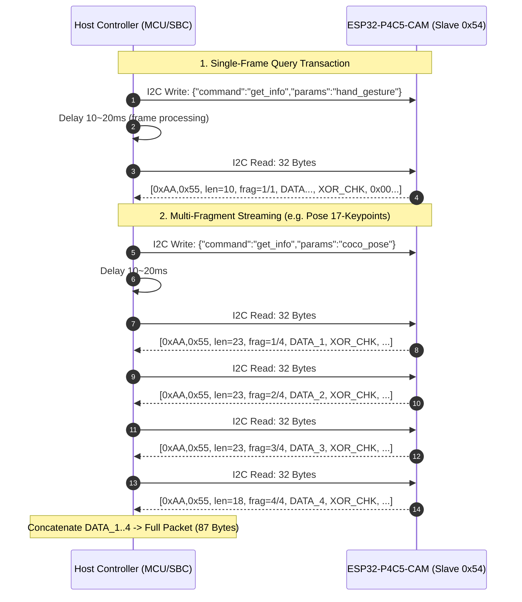

# Offline Vision I²C Protocol Specification

**English** | [简体中文](i2c_protocol_zh.md)

---

## 1. Frame Format

The ESP32-P4C5-CAM offline vision module acts as an **I²C slave** (7-bit address `0x54` for offline AI vision firmwares, `0x52` for Wi-Fi streaming firmware, recommended `400 kHz`).
- **Host → Slave**: Write a UTF-8 JSON command string directly over I²C (no extra frame header or checksum).
- **Slave → Host**: Read fixed **32-byte response frames**. Payloads exceeding one frame's capacity are split into multiple sequential 32-byte fragments.



### 1.1 Host Request Format

| Field | Type | Description |
| :--- | :--- | :--- |
| `command` | string | Command name, e.g. `get_info`, `vision_setting`, `play_voice_prompt` |
| `params` | string / number / object | Command parameters (see feature sections below) |

### 1.2 Slave Response Frame Format (32 Bytes Fixed)

| Offset | Length | Field | Type | Description |
| :--- | :--- | :--- | :--- | :--- |
| `0` | 1 | Header High | uint8 | Fixed `0xAA` |
| `1` | 1 | Header Low | uint8 | Fixed `0x55` |
| `2 ~ 3` | 2 | `data_len` | uint16 | Valid payload length in this frame (little-endian) |
| `4 ~ 5` | 2 | `fragment_id` | uint16 | Fragment index, 1-based (little-endian) |
| `6 ~ 7` | 2 | `total_fragments` | uint16 | Total number of fragments (little-endian) |
| `8 ~ 8 + data_len - 1` | `data_len` | `DATA` | bytes | Payload slice for this fragment |
| `8 + data_len` | 1 | `CHECKSUM` | uint8 | Byte-wise XOR of all `data_len` bytes in `DATA` |
| Remaining bytes | - | Padding | bytes | Ignored by parser |

Maximum `DATA` payload per frame is `32 - 8 - 1 = 23` bytes. Reassemble the full `DATA` buffer by concatenating fragments in ascending `fragment_id` order (`1 .. total_fragments`).

### 1.3 Endianness & Checksum

- All multi-byte integers (`uint16`, etc.) are **little-endian**.
- `float32` uses **IEEE 754 single-precision** little-endian format.
- `CHECKSUM` covers only the `data_len` bytes of `DATA` in the current frame:

```c
uint8_t checksum = 0;
for (size_t i = 0; i < data_len; i++) {
    checksum ^= data[i];
}
```

---

## 2. Parsing Workflow

### 2.1 Host Request Sequence

1. Build the JSON command string for the target feature.
2. Write the null-terminated JSON string to the I²C slave.
3. For commands that return data, wait briefly and read 32-byte response frames.
4. Inspect `total_fragments` in the first frame header and read remaining fragments if `total_fragments > 1`.

> Note: `play_voice_prompt` is write-only and defines no I²C response data.

### 2.2 Single-Frame Validation

1. Read 32 bytes.
2. Verify `buf[0] == 0xAA` and `buf[1] == 0x55`.
3. Parse `data_len`, `fragment_id`, `total_fragments` (little-endian).
4. Validate `1 <= data_len <= 23` and `1 <= fragment_id <= total_fragments`.
5. Compute XOR checksum over `buf[8 : 8 + data_len]` and verify it equals `buf[8 + data_len]`.

### 2.3 Multi-Fragment Reassembly & Common Rules

- First frame must have `fragment_id == 1`; subsequent frames increment `2, 3, ...` with identical `total_fragments`.
- When no target is detected, the reassembled `DATA` buffer is a single byte `data[0] = 0`.
- Bounding-box `uint16` coordinates/dimensions are reconstructed as `val = low | (high << 8)`.
- For fixed-size detection records, `data[0]` is target count followed by fixed-length records. For variable-length records (QR codes, human pose), advance using each record's length or keypoint count.

---

## 3. Face Detection

- **Request**: `{"command": "get_info", "params": "human"}`
- **No detection**: `data[0] = 0` (1 byte)
- **Detected**: `9` bytes per face after `data[0]`

| Offset | Type | Description |
| :--- | :--- | :--- |
| `data[0]` | uint8 | Total detected faces |
| `data[1]` | uint8 | Face #1 index/ID |
| `data[2..3]` | uint16 | Bounding box `x` (LE) |
| `data[4..5]` | uint16 | Bounding box `y` (LE) |
| `data[6..7]` | uint16 | Bounding box `width` (LE) |
| `data[8..9]` | uint16 | Bounding box `height` (LE) |
| `data[1 + 9 * (N - 1)] ...` | - | Face #N record (9 bytes each) |

---

## 4. Cat & Dog Detection

- **Request**: `{"command": "get_info", "params": "cat"}` or `{"command": "get_info", "params": "dog"}`
- **No detection**: `data[0] = 0`
- **Detected**: Same layout as Section 3 (`data[0]` = count, followed by 9 bytes per target: `id (1B)`, `x (2B)`, `y (2B)`, `w (2B)`, `h (2B)`).

---

## 5. Pedestrian Detection

- **Request**: `{"command": "get_info", "params": "pedestrian"}`
- **No detection**: `data[0] = 0`
- **Detected**: Same 9-byte-per-target layout as Section 3 (`data[0]` = pedestrian count).

---

## 6. YOLO11n Object Detection (80 COCO Classes)

- **Request**: `{"command": "get_info", "params": "coco_detect"}`
- **No detection**: `data[0] = 0`
- **Detected**: Same 9-byte-per-target layout as Section 3 (`data[1 + 9*(N-1)]` is the COCO class ID `0..79`).

<details>
<summary>COCO Class ID Table (0 – 79)</summary>

| ID | Class | ID | Class | ID | Class |
| :-: | :--- | :-: | :--- | :-: | :--- |
| 0 | person | 27 | tie | 54 | donut |
| 1 | bicycle | 28 | suitcase | 55 | cake |
| 2 | car | 29 | frisbee | 56 | chair |
| 3 | motorcycle | 30 | skis | 57 | couch |
| 4 | airplane | 31 | snowboard | 58 | potted plant |
| 5 | bus | 32 | sports ball | 59 | bed |
| 6 | train | 33 | kite | 60 | dining table |
| 7 | truck | 34 | baseball bat | 61 | toilet |
| 8 | boat | 35 | baseball glove | 62 | tv |
| 9 | traffic light | 36 | skateboard | 63 | laptop |
| 10 | fire hydrant | 37 | surfboard | 64 | mouse |
| 11 | stop sign | 38 | tennis racket | 65 | remote |
| 12 | parking meter | 39 | bottle | 66 | keyboard |
| 13 | bench | 40 | wine glass | 67 | cell phone |
| 14 | bird | 41 | cup | 68 | microwave |
| 15 | cat | 42 | fork | 69 | oven |
| 16 | dog | 43 | knife | 70 | toaster |
| 17 | horse | 44 | spoon | 71 | sink |
| 18 | sheep | 45 | bowl | 72 | refrigerator |
| 19 | cow | 46 | banana | 73 | book |
| 20 | elephant | 47 | apple | 74 | clock |
| 21 | bear | 48 | sandwich | 75 | vase |
| 22 | zebra | 49 | orange | 76 | scissors |
| 23 | giraffe | 50 | broccoli | 77 | teddy bear |
| 24 | backpack | 51 | carrot | 78 | hair drier |
| 25 | umbrella | 52 | hot dog | 79 | toothbrush |
| 26 | handbag | 53 | pizza | | |

</details>

---

## 7. Color Blob & Line Tracking

### 7.1 Query Active Config

- **Request**: `{"command": "get_info", "params": "color_config"}`
- **Response**: `data[0]` = mode (`0`: color blob, `1`: line tracking); `data[1..N]` = configured color IDs (`1 <= N <= 5`).

### 7.2 Set Vision Mode & Targets

- **Request**:
```json
{
  "command": "vision_setting",
  "params": {
    "mode": 0,
    "target": [1, 2, 3, 4, 5]
  }
}
```
  - `mode`: `0` = color blob tracking, `1` = line tracking (line tracking selects 1 color ID).
- **Response**: `data[0]` (`0`: failed, `1`: success).

### 7.3 Query Detection Result

- **Request**: `{"command": "get_info", "params": "color_result"}`
- **Color Blob Mode (`mode = 0`)**: `data[0] = 0` when none detected; otherwise 9 bytes per color block (`id`, `x`, `y`, `w`, `h`).
- **Line Tracking Mode (`mode = 1`)**: `data[0] = 0` when no line detected; otherwise:

| Offset | Type | Description |
| :--- | :--- | :--- |
| `data[0]` | uint8 | Line detected flag (`0`: no, `1`: yes) |
| `data[1..2]` | uint16 | Segment start `x` (LE) |
| `data[3..4]` | uint16 | Segment start `y` (LE) |
| `data[5..6]` | uint16 | Segment end `x` (LE) |
| `data[7..8]` | uint16 | Segment end `y` (LE) |
| `data[9..12]` | float32 | Line angle relative to vertical axis (degrees, LE) |
| `data[13..16]` | float32 | Lateral offset of line center from frame center (`-1.0 ~ 1.0`, LE) |

---

## 8. Hand Gesture Recognition

- **Request**: `{"command": "get_info", "params": "hand_gesture"}`
- **Class IDs**: `0: one`, `1: two`, `2: three`, `3: four`, `4: five`, `5: like`, `6: ok`, `7: no_gesture`, `8: call`, `9: dislike`
- **Response**: `data[0] = 0` when none detected; otherwise 9 bytes per gesture (`class_id`, `x`, `y`, `w`, `h`).

---

## 9. Human Pose Estimation (17 Keypoints)

- **Request**: `{"command": "get_info", "params": "coco_pose"}`
- **No detection**: `data[0] = 0`
- **Detected**: `data[0]` = pose count, followed by variable-length records starting at `base = 1`:

| Offset | Type | Description |
| :--- | :--- | :--- |
| `base + 0` | uint8 | Pose index |
| `base + 1..2` | uint16 | Bounding box `x` |
| `base + 3..4` | uint16 | Bounding box `y` |
| `base + 5..6` | uint16 | Bounding box `width` |
| `base + 7..8` | uint16 | Bounding box `height` |
| `base + 9` | uint8 | `keypoint_count` |
| `base + 10 ..` | `5 * keypoint_count` bytes | Each keypoint: `id (uint8)`, `x (uint16)`, `y (uint16)` |

Next pose offset: `base = base + 10 + 5 * keypoint_count`.

- **Keypoint IDs (`0–16`)**: `0: nose`, `1: left_eye`, `2: right_eye`, `3: left_ear`, `4: right_ear`, `5: left_shoulder`, `6: right_shoulder`, `7: left_elbow`, `8: right_elbow`, `9: left_wrist`, `10: right_wrist`, `11: left_hip`, `12: right_hip`, `13: left_knee`, `14: right_knee`, `15: left_ankle`, `16: right_ankle`.

---

## 10. QR Code Recognition

- **Request**: `{"command": "get_info", "params": "qrcode"}`
- **No detection**: `data[0] = 0`
- **Detected**: `data[0]` = QR count, followed by variable-length records (`11 + str_len` bytes each, starting at `base = 1`):

| Offset | Type | Description |
| :--- | :--- | :--- |
| `base + 0` | uint8 | QR code index |
| `base + 1..2` | uint16 | Bounding box `x` |
| `base + 3..4` | uint16 | Bounding box `y` |
| `base + 5..6` | uint16 | Bounding box `width` |
| `base + 7..8` | uint16 | Bounding box `height` |
| `base + 9..10` | uint16 | Decoded string length `str_len` (LE) |
| `base + 11 .. base + 10 + str_len` | bytes | Raw decoded string bytes (not null-terminated) |

---

## 11. AprilTag Recognition (`tag36h11`)

- **Request**: `{"command": "get_info", "params": "apriltag_recognition"}`
- **No detection**: `data[0] = 0`
- **Detected**: `data[0]` = tag count, followed by **38 bytes per tag**:

| Offset | Type | Description |
| :--- | :--- | :--- |
| `base + 0..1` | uint16 | Tag ID (LE) |
| `base + 2..3` | uint16 | Bounding box `x` |
| `base + 4..5` | uint16 | Bounding box `y` |
| `base + 6..7` | uint16 | Bounding box `width` |
| `base + 8..9` | uint16 | Bounding box `height` |
| `base + 10..13` | float32 | In-plane `rotation` |
| `base + 14..17` | float32 | `x_translation` |
| `base + 18..21` | float32 | `y_translation` |
| `base + 22..25` | float32 | `z_translation` |
| `base + 26..29` | float32 | `x_rotation` |
| `base + 30..33` | float32 | `y_rotation` |
| `base + 34..37` | float32 | `z_rotation` |

*(For the first tag, `base = 1`; for the N-th tag, `base = 1 + 38 * (N - 1)`.)*
