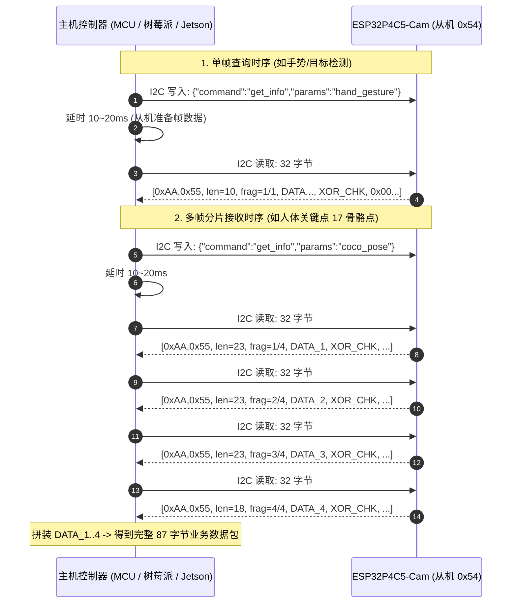

# 离线视觉 I²C 从机通讯协议规范

[English](i2c_protocol_en.md) | **简体中文**


## 1. 协议帧格式

ESP32-P4C5-CAM 视觉模块作为 I²C 从机（离线视觉固件 7 位默认从机地址为 `0x54`，图传固件地址为 `0x52`，推荐总线速率 `400 kHz`）与上位机通信。主机向从机发送指令时，直接写入 UTF-8 编码的 JSON 字符串；从机返回识别结果时，使用固定 32 字节响应帧。若一次 DATA 数据超过单帧可承载长度，则拆分为多个 32 字节帧连续返回。

### 1.1 主机发送格式 (JSON)

主机发送内容为 UTF-8 编码的 JSON 文本字符串，不额外添加帧头或校验字节。JSON 字段含义如下：



| 字段 | 类型 | 说明 |
| ---- | ---- | ---- |
| `command` | string | 指令名称，例如 `get_info`、`vision_setting`、`play_voice_prompt` |
| `params` | string/number/object | 指令参数，具体格式见各功能章节 |

### 1.2 从机响应帧格式 (32 字节固定)

从机每次返回固定读取 32 字节，帧格式如下：

| 偏移 | 长度 | 字段 | 类型 | 说明 |
| ---- | ---- | ---- | ---- | ---- |
| `0` | 1 | 帧头高字节 | uint8 | 固定为 `0xAA` |
| `1` | 1 | 帧头低字节 | uint8 | 固定为 `0x55` |
| `2 ~ 3` | 2 | `data_len` | uint16 | 本帧 DATA 区有效数据长度，小端序 |
| `4 ~ 5` | 2 | `fragment_id` | uint16 | 当前分片序号，小端序，从 `1` 开始 |
| `6 ~ 7` | 2 | `total_fragments` | uint16 | 总分片数量，小端序 |
| `8 ~ 8 + data_len - 1` | `data_len` | DATA | bytes | 本帧有效载荷 |
| `8 + data_len` | 1 | CHECKSUM | uint8 | 对本帧 DATA 区所有有效字节逐字节异或得到 |
| 剩余字节 | - | 保留 | bytes | 固定帧补齐字节，解析时忽略 |

单帧最大 DATA 长度为 `32 - 8 - 1 = 23` 字节。完整业务数据由所有分片的 DATA 区按 `fragment_id` 从小到大拼接得到。

### 1.3 字节序与校验规则

- 多字节整数均为小端序，即低字节在前、高字节在后。
- `float32` 使用 IEEE 754 单精度浮点格式，小端序。
- CHECKSUM 仅计算本帧 DATA 区有效数据，不包含帧头、长度、分片信息、校验字节和补齐字节。
- 校验计算方式：

```c
uint8_t checksum = 0;
for (size_t i = 0; i < data_len; i++) {
    checksum ^= data[i];
}
```


## 2. 通信与解析流程

### 2.1 主机请求流程

1. 按功能章节构造 JSON 指令字符串。
2. 通过 I2C 将 JSON 字符串写入从机。
3. 若该指令有返回数据，等待从机准备响应后读取 32 字节响应帧。
4. 根据响应帧头中的 `total_fragments` 判断是否需要继续读取后续分片。

`play_voice_prompt` 语音播报指令只要求主机发送 JSON 指令，协议未定义 I2C 响应数据。

### 2.2 单帧解析流程

1. 读取固定 32 字节。
2. 校验 `data[0] == 0xAA` 且 `data[1] == 0x55`。
3. 按小端序解析 `data_len`、`fragment_id`、`total_fragments`。
4. 检查 `data_len` 范围为 `1 ~ 23`。
5. 检查 `fragment_id` 范围为 `1 ~ total_fragments`。
6. 对 DATA 区有效字节计算异或校验，并与 CHECKSUM 字节比较。
7. 校验通过后提取本帧 DATA 区。

### 2.3 多分片组包流程

1. 第一帧的 `fragment_id` 应为 `1`，记录 `total_fragments`。
2. 后续每帧的 `fragment_id` 应按 `2、3、...` 递增。
3. 所有帧的 `total_fragments` 应保持一致。
4. 将每帧 DATA 区按顺序拼接，得到完整 DATA 包。
5. 根据具体功能章节解析完整 DATA 包。

### 2.4 通用 DATA 载荷解析规则

- 若某检测类功能未检测到目标，通常返回完整 DATA 包 `data[0] = 0`。
- 目标框坐标、宽度、高度等 `uint16` 字段均按小端序组合，例如 `x = data[2] | (data[3] << 8)`。
- 对固定长度目标记录，通常 `data[0]` 为目标数量，后续每个目标占用固定字节数。
- 对二维码、人体姿态等变长记录，应按当前记录中的长度字段或关键点数量计算下一条记录的起始偏移。


## 3. 人脸检测 (Face Detection)

### 3.1 主机发送指令

```json
{
  "command": "get_info",
  "params": "human"
}
```


### 3.2 从机返回 DATA 区数据

未检测人脸时：data区只有`data[0] = 0`一个字节的数据。

检测到人脸时，DATA包数据如下：

| 偏移                    | 类型  | 说明                  |
| ----------------------- | ----- | --------------------- |
| `data[0]`               | uint8 | 检测到人脸的总数量    |
| `data[1]`               | uint8 | 第一个人脸的序号      |
| `data[2]`               | uint8 | 检测框 X 轴位置低八位 |
| `data[3]`               | uint8 | 检测框 X 轴位置高八位 |
| `data[4]`               | uint8 | 检测框 Y 轴位置低八位 |
| `data[5]`               | uint8 | 检测框 Y 轴位置高八位 |
| `data[6]`               | uint8 | 检测框宽度低八位      |
| `data[7]`               | uint8 | 检测框宽度高八位      |
| `data[8]`               | uint8 | 检测框高度低八位      |
| `data[9]`               | uint8 | 检测框高度高八位      |
| `data[1 + 9 * (N - 1)]` | uint8 | 第N个人脸的序号       |
| ...                     |       |                       |


## 4. 猫狗检测 (Cat & Dog Detection)

### 4.1 主机发送指令

```json
{
  "command": "get_info",
  "params": "cat"
}

//or

{
  "command": "get_info",
  "params": "dog"
}
```


### 4.2 从机返回 DATA 区数据

未检测到猫(狗)时：data区只有`data[0] = 0`一个字节的数据。

检测到猫(狗)时，DATA包数据如下：

| 偏移                    | 类型  | 说明                  |
| ----------------------- | ----- | --------------------- |
| `data[0]`               | uint8 | 检测目标总数量        |
| `data[1]`               | uint8 | 第一个目标序号        |
| `data[2]`               | uint8 | 检测框 X 轴位置低八位 |
| `data[3]`               | uint8 | 检测框 X 轴位置高八位 |
| `data[4]`               | uint8 | 检测框 Y 轴位置低八位 |
| `data[5]`               | uint8 | 检测框 Y 轴位置高八位 |
| `data[6]`               | uint8 | 检测框宽度低八位      |
| `data[7]`               | uint8 | 检测框宽度高八位      |
| `data[8]`               | uint8 | 检测框高度低八位      |
| `data[9]`               | uint8 | 检测框高度高八位      |
| `data[1 + 9 * (N - 1)]` | uint8 | 第N个目标的序号       |
| ...                     |       |                       |


## 5. 行人检测 (Pedestrian Detection)

### 5.1 主机发送指令

```json
{
  "command": "get_info",
  "params": "pedestrian"
}
```


### 5.2 从机返回 DATA 区数据

未检测到目标时：data区只有`data[0] = 0`一个字节的数据。

检测到目标时，DATA包数据如下：

| 偏移                    | 类型  | 说明                  |
| ----------------------- | ----- | --------------------- |
| `data[0]`               | uint8 | 检测到行人的总数量    |
| `data[1]`               | uint8 | 第一位行人的序号      |
| `data[2]`               | uint8 | 检测框 X 轴位置低八位 |
| `data[3]`               | uint8 | 检测框 X 轴位置高八位 |
| `data[4]`               | uint8 | 检测框 Y 轴位置低八位 |
| `data[5]`               | uint8 | 检测框 Y 轴位置高八位 |
| `data[6]`               | uint8 | 检测框宽度低八位      |
| `data[7]`               | uint8 | 检测框宽度高八位      |
| `data[8]`               | uint8 | 检测框高度低八位      |
| `data[9]`               | uint8 | 检测框高度高八位      |
| `data[1 + 9 * (N - 1)]` | uint8 | 第N位行人的序号       |
| ...                     |       |                       |


## 6. YOLO11n 目标检测 (80 类目标)

### 6.1 目标类别映射表

| 序号 | 英文类别      | 中文对照   | 序号 | 英文类别       | 中文对照   | 序号 | 英文类别     | 中文对照   |
| ---- | ------------- | ---------- | ---- | -------------- | ---------- | ---- | ------------ | ---------- |
| 0    | person        | 人         | 27   | tie            | 领带       | 54   | donut        | 甜甜圈     |
| 1    | bicycle       | 自行车     | 28   | suitcase       | 行李箱     | 55   | cake         | 蛋糕       |
| 2    | car           | 汽车       | 29   | frisbee        | 飞盘       | 56   | chair        | 椅子       |
| 3    | motorcycle    | 摩托车     | 30   | skis           | 滑雪板     | 57   | couch        | 沙发       |
| 4    | airplane      | 飞机       | 31   | snowboard      | 单板滑雪板 | 58   | potted plant | 盆栽       |
| 5    | bus           | 公交车     | 32   | sports ball    | 运动球     | 59   | bed          | 床         |
| 6    | train         | 火车       | 33   | kite           | 风筝       | 60   | dining table | 餐桌       |
| 7    | truck         | 卡车       | 34   | baseball bat   | 棒球棒     | 61   | toilet       | 马桶       |
| 8    | boat          | 船         | 35   | baseball glove | 棒球手套   | 62   | tv           | 电视       |
| 9    | traffic light | 交通信号灯 | 36   | skateboard     | 滑板       | 63   | laptop       | 笔记本电脑 |
| 10   | fire hydrant  | 消防栓     | 37   | surfboard      | 冲浪板     | 64   | mouse        | 鼠标       |
| 11   | stop sign     | 停止标志   | 38   | tennis racket  | 网球拍     | 65   | remote       | 遥控器     |
| 12   | parking meter | 停车计时器 | 39   | bottle         | 瓶子       | 66   | keyboard     | 键盘       |
| 13   | bench         | 长椅       | 40   | wine glass     | 酒杯       | 67   | cell phone   | 手机       |
| 14   | bird          | 鸟         | 41   | cup            | 杯子       | 68   | microwave    | 微波炉     |
| 15   | cat           | 猫         | 42   | fork           | 叉子       | 69   | oven         | 烤箱       |
| 16   | dog           | 狗         | 43   | knife          | 刀         | 70   | toaster      | 烤面包机   |
| 17   | horse         | 马         | 44   | spoon          | 勺子       | 71   | sink         | 水槽       |
| 18   | sheep         | 羊         | 45   | bowl           | 碗         | 72   | refrigerator | 冰箱       |
| 19   | cow           | 牛         | 46   | banana         | 香蕉       | 73   | book         | 书         |
| 20   | elephant      | 大象       | 47   | apple          | 苹果       | 74   | clock        | 时钟       |
| 21   | bear          | 熊         | 48   | sandwich       | 三明治     | 75   | vase         | 花瓶       |
| 22   | zebra         | 斑马       | 49   | orange         | 橙子       | 76   | scissors     | 剪刀       |
| 23   | giraffe       | 长颈鹿     | 50   | broccoli       | 西兰花     | 77   | teddy bear   | 泰迪熊     |
| 24   | backpack      | 背包       | 51   | carrot         | 胡萝卜     | 78   | hair drier   | 吹风机     |
| 25   | umbrella      | 雨伞       | 52   | hot dog        | 热狗       | 79   | toothbrush   | 牙刷       |
| 26   | handbag       | 手提包     | 53   | pizza          | 披萨       |      |              |            |


### 6.2 主机发送指令

```json
{
  "command": "get_info",
  "params": "coco_detect"
}
```


### 6.3 从机返回 DATA 区数据

未检测到目标时：data区只有`data[0] = 0`一个字节的数据。

检测到目标时，DATA包数据如下：

| 偏移                    | 类型  | 说明                  |
| ----------------------- | ----- | --------------------- |
| `data[0]`               | uint8 | 检测到目标的总数量    |
| `data[1]`               | uint8 | 第一个目标的序号      |
| `data[2]`               | uint8 | 检测框 X 轴位置低八位 |
| `data[3]`               | uint8 | 检测框 X 轴位置高八位 |
| `data[4]`               | uint8 | 检测框 Y 轴位置低八位 |
| `data[5]`               | uint8 | 检测框 Y 轴位置高八位 |
| `data[6]`               | uint8 | 检测框宽度低八位      |
| `data[7]`               | uint8 | 检测框宽度高八位      |
| `data[8]`               | uint8 | 检测框高度低八位      |
| `data[9]`               | uint8 | 检测框高度高八位      |
| `data[1 + 9 * (N - 1)]` | uint8 | 第N个目标的序号       |
| ...                     |       |                       |


## 7. 颜色识别与巡线 (Color Detect & Line Tracking)

### 7.1 获取当前配置

```json
{
  "command": "get_info",
  "params": "color_config"
}
```


### 7.2 返回配置数据

| 偏移      | 类型  | 说明                               |
| --------- | ----- | ---------------------------------- |
| `data[0]` | uint8 | 当前模式 0-颜色识别 1-巡线         |
| `data[1]` | uint8 | 第 1 个设置的追踪颜色序号          |
| `...`     | uint8 | 其余设置的追踪颜色序号             |
| `data[N]` | uint8 | 第 N 个设置的追踪颜色序号（1≤N≤5） |

DATA 区长度为 `1 + 追踪颜色数量`，追踪颜色数量由数据包长度得出，不再单独返回。


### 7.3 模式与目标设置

#### 7.3.1 设置指令

```json
{
  "command": "vision_setting",
  "params": {
    "mode": 0,
    "target": [1,2,3,4,5]
  }
}
```

| 字段   | 类型  | 说明                                                         |
| ------ | ----- | ------------------------------------------------------------ |
| mode   | uint8 | 0-颜色识别 1-巡线                                            |
| target | list  | 指定需要识别的颜色,  颜色识别模式下，1≤识别的个数≤已注册的颜色种类个数，巡线模式下只能选取1种颜色 |


#### 7.3.2 返回数据

| 偏移      | 类型  | 说明                  |
| --------- | ----- | --------------------- |
| `data[0]` | uint8 | 0-设置失败 1-设置成功 |


### 7.4 获取识别与巡线数据

#### 7.4.1 获取指令

```json
{
  "command": "get_info",
  "params": "color_result"
}
```


#### 7.4.2 颜色识别模式返回数据

##### 从机 DATA 区数据

未检测到颜色块时：data区只有`data[0] = 0`一个字节的数据。

检测到颜色块时，DATA包数据如下：

| 偏移                    | 类型  | 说明                  |
| ----------------------- | ----- | --------------------- |
| `data[0]`               | uint8 | 检测到的颜色块总数量  |
| `data[1]`               | uint8 | 第一个颜色块序号      |
| `data[2]`               | uint8 | 检测框 X 轴位置低八位 |
| `data[3]`               | uint8 | 检测框 X 轴位置高八位 |
| `data[4]`               | uint8 | 检测框 Y 轴位置低八位 |
| `data[5]`               | uint8 | 检测框 Y 轴位置高八位 |
| `data[6]`               | uint8 | 检测框宽度低八位      |
| `data[7]`               | uint8 | 检测框宽度高八位      |
| `data[8]`               | uint8 | 检测框高度低八位      |
| `data[9]`               | uint8 | 检测框高度高八位      |
| `data[1 + 9 * (N - 1)]` | uint8 | 第N个颜色块序号       |
| ...                     |       |                       |


#### 7.4.3 巡线模式返回数据

##### 从机 DATA 区数据

未检测到线条时：data区只有`data[0] = 0`一个字节的数据。

检测到线条时：

| 偏移                  | 类型    | 说明                                                      |
| --------------------- | ------- | --------------------------------------------------------- |
| `data[0]`             | uint8   | 是否检测到线条：`0` 未检测到，`1` 已检测到                |
| `data[1]`             | uint8   | 线段起点 X 低八位                                         |
| `data[2]`             | uint8   | 线段起点 X 高八位                                         |
| `data[3]`             | uint8   | 线段起点 Y 低八位                                         |
| `data[4]`             | uint8   | 线段起点 Y 高八位                                         |
| `data[5]`             | uint8   | 线段终点 X 低八位                                         |
| `data[6]`             | uint8   | 线段终点 X 高八位                                         |
| `data[7]`             | uint8   | 线段终点 Y 低八位                                         |
| `data[8]`             | uint8   | 线段终点 Y 高八位                                         |
| `data[9] ~ data[12]`  | float32 | 线条相对画面纵向的角度，单位为度，小端序                  |
| `data[13] ~ data[16]` | float32 | 线条中心相对画面中心的横向偏移，范围 `-1.0 ~ 1.0`，小端序 |


## 8. 手势识别 (Hand Gesture Recognition)

### 8.1 手势分类序号

| 序号 | 说明       |
| ---- | ---------- |
| 0    | one        |
| 1    | two        |
| 2    | three      |
| 3    | four       |
| 4    | five       |
| 5    | like       |
| 6    | ok         |
| 7    | no_gesture |
| 8    | call       |
| 9    | dislike    |


### 8.2 主机发送指令

```json
{
  "command": "get_info",
  "params": "hand_gesture"
}
```


### 8.3 从机返回 DATA 区数据

未检测到手势时：data区只有`data[0] = 0`一个字节的数据。

检测到手势时，DATA包数据如下：

| 偏移                    | 类型  | 说明                  |
| ----------------------- | ----- | --------------------- |
| `data[0]`               | uint8 | 检测到手势的总数量    |
| `data[1]`               | uint8 | 第一种手势的分类序号  |
| `data[2]`               | uint8 | 检测框 X 轴位置低八位 |
| `data[3]`               | uint8 | 检测框 X 轴位置高八位 |
| `data[4]`               | uint8 | 检测框 Y 轴位置低八位 |
| `data[5]`               | uint8 | 检测框 Y 轴位置高八位 |
| `data[6]`               | uint8 | 检测框宽度低八位      |
| `data[7]`               | uint8 | 检测框宽度高八位      |
| `data[8]`               | uint8 | 检测框高度低八位      |
| `data[9]`               | uint8 | 检测框高度高八位      |
| `data[1 + 9 * (N - 1)]` | uint8 | 第N种手势的分类序号   |
| ...                     |       |                       |


## 9. 人体姿态检测 (Body Pose Estimation)

### 9.1 主机发送指令

```json
{
  "command": "get_info",
  "params": "coco_pose"
}
```


### 9.2 从机返回 DATA 区数据

未检测到人体姿态时：

| 偏移      | 类型    | 说明                             |
| --------- | ------- | -------------------------------- |
| `data[0]` | `uint8` | 固定为 `0`，表示未检测到人体姿态 |


检测到人体姿态时：

| 偏移      | 类型    | 说明                   |
| --------- | ------- | ---------------------- |
| `data[0]` | `uint8` | 检测到的人体姿态总数量 |

从 `data[1]` 开始，依次存放每个人体姿态数据。


### 9.3 单个人体姿态数据格式

| 偏移                  | 类型       | 说明               |
| --------------------- | ---------- | ------------------ |
| `base + 0`            | `uint8`    | 人体姿态序号       |
| `base + 1 ~ base + 2` | `uint16`   | 检测框 X 坐标      |
| `base + 3 ~ base + 4` | `uint16`   | 检测框 Y 坐标      |
| `base + 5 ~ base + 6` | `uint16`   | 检测框宽度         |
| `base + 7 ~ base + 8` | `uint16`   | 检测框高度         |
| `base + 9`            | `uint8`    | 检测到的关键点数量 |
| `base + 10` 开始      | 关键点数据 | 依次存放关键点     |


### 9.4 单个关键点数据格式

每个关键点占用 **5 字节**。

| 偏移      | 类型     | 说明          |
| --------- | -------- | ------------- |
| `+0`      | `uint8`  | 关键点序号    |
| `+1 ~ +2` | `uint16` | 关键点 X 坐标 |
| `+3 ~ +4` | `uint16` | 关键点 Y 坐标 |


### 9.5 字段说明

- 多字节数据均为 **低字节在前，高字节在后**。
- 每个人体姿态长度不是固定的，由关键点数量决定。
- 单个人体姿态长度为：

```
10 + 5 * 关键点数量
```


### 9.6 关键点序号对应表

| 序号 | 关键点        | 序号 | 关键点         | 序号 | 关键点      |
| ---- | ------------- | ---- | -------------- | ---- | ----------- |
| 0    | nose          | 6    | right_shoulder | 12   | right_hip   |
| 1    | left_eye      | 7    | left_elbow     | 13   | left_knee   |
| 2    | right_eye     | 8    | right_elbow    | 14   | right_knee  |
| 3    | left_ear      | 9    | left_wrist     | 15   | left_ankle  |
| 4    | right_ear     | 10   | right_wrist    | 16   | right_ankle |
| 5    | left_shoulder | 11   | left_hip       |      |             |


### 9.7 下一个人体姿态偏移计算

解析完当前人体姿态后，下一个人体姿态的起始偏移为：

```
base = base + 10 + 5 * keypoint_count;
```


## 10. 二维码识别 (QR Code Recognition)

### 10.1 主机发送指令

```json
{
  "command": "get_info",
  "params": "qrcode"
}
```


### 10.2 从机返回 DATA 区数据

未检测到二维码时：data区只有`data[0] = 0`一个字节的数据。

检测到二维码时，每个二维码数据长度为 `11 + 字符串长度` 字节。第N个二维码的起始偏移为 `base`，第一个二维码 `base = 1`，下一个二维码的 `base = 当前base + 11 + 当前二维码字符串长度`。

| 偏移              | 类型  | 说明                  |
| ----------------- | ----- | --------------------- |
| `data[0]`         | uint8 | 检测到二维码的总数量  |
| `data[base]`      | uint8 | 第N个二维码的序号     |
| `data[base + 1]`  | uint8 | 检测框 X 轴位置低八位 |
| `data[base + 2]`  | uint8 | 检测框 X 轴位置高八位 |
| `data[base + 3]`  | uint8 | 检测框 Y 轴位置低八位 |
| `data[base + 4]`  | uint8 | 检测框 Y 轴位置高八位 |
| `data[base + 5]`  | uint8 | 检测框宽度低八位      |
| `data[base + 6]`  | uint8 | 检测框宽度高八位      |
| `data[base + 7]`  | uint8 | 检测框高度低八位      |
| `data[base + 8]`  | uint8 | 检测框高度高八位      |
| `data[base + 9]`  | uint8 | 字符串长度低八位      |
| `data[base + 10]` | uint8 | 字符串长度高八位      |
| `data[base + 11]` | uint8 | 字符串第1个字节       |
| ...               |       |                       |

字符串长度为 `uint16` 小端序，字符串内容按二维码解码出的原始字节顺序发送，不额外添加 `\0` 结束符。


## 11. AprilTag 识别 (tag36h11)

### 11.1 获取 AprilTag 识别数据

**标签类型**

当前 `apriltag_recognition` 使用 `tag36h11` 标签族。标签 ID 为 AprilTag 图案本身编码的 ID，范围由标签族决定。

#### 11.1.1 主机发送指令

```json
{
  "command": "get_info",
  "params": "apriltag_recognition"
}
```


#### 11.1.2 从机返回 DATA 区数据

未识别到 AprilTag 时：DATA 区只有 `data[0] = 0` 一个字节的数据。

识别到 AprilTag 时，DATA 包数据如下：

| 偏移                     | 类型    | 说明                                |
| ------------------------ | ------- | ----------------------------------- |
| `data[0]`                | uint8   | 识别到 AprilTag 的总数量            |
| `data[1]`                | uint8   | 第一个标签 ID 低八位                |
| `data[2]`                | uint8   | 第一个标签 ID 高八位                |
| `data[3]`                | uint8   | 标签框 X 轴位置低八位               |
| `data[4]`                | uint8   | 标签框 X 轴位置高八位               |
| `data[5]`                | uint8   | 标签框 Y 轴位置低八位               |
| `data[6]`                | uint8   | 标签框 Y 轴位置高八位               |
| `data[7]`                | uint8   | 标签框宽度低八位                    |
| `data[8]`                | uint8   | 标签框宽度高八位                    |
| `data[9]`                | uint8   | 标签框高度低八位                    |
| `data[10]`               | uint8   | 标签框高度高八位                    |
| `data[11] ~ data[14]`    | float32 | 标签在图像平面内的旋转角 `rotation` |
| `data[15] ~ data[18]`    | float32 | X 方向位移 `x_translation`          |
| `data[19] ~ data[22]`    | float32 | Y 方向位移 `y_translation`          |
| `data[23] ~ data[26]`    | float32 | Z 方向位移 `z_translation`          |
| `data[27] ~ data[30]`    | float32 | 绕 X 轴旋转角 `x_rotation`          |
| `data[31] ~ data[34]`    | float32 | 绕 Y 轴旋转角 `y_rotation`          |
| `data[35] ~ data[38]`    | float32 | 绕 Z 轴旋转角 `z_rotation`          |
| `data[1 + 38 * (N - 1)]` | uint8   | 第 N 个标签 ID 低八位               |
| `data[2 + 38 * (N - 1)]` | uint8   | 第 N 个标签 ID 高八位               |
| `...`                    |         | 后续字段按相同格式排列              |
