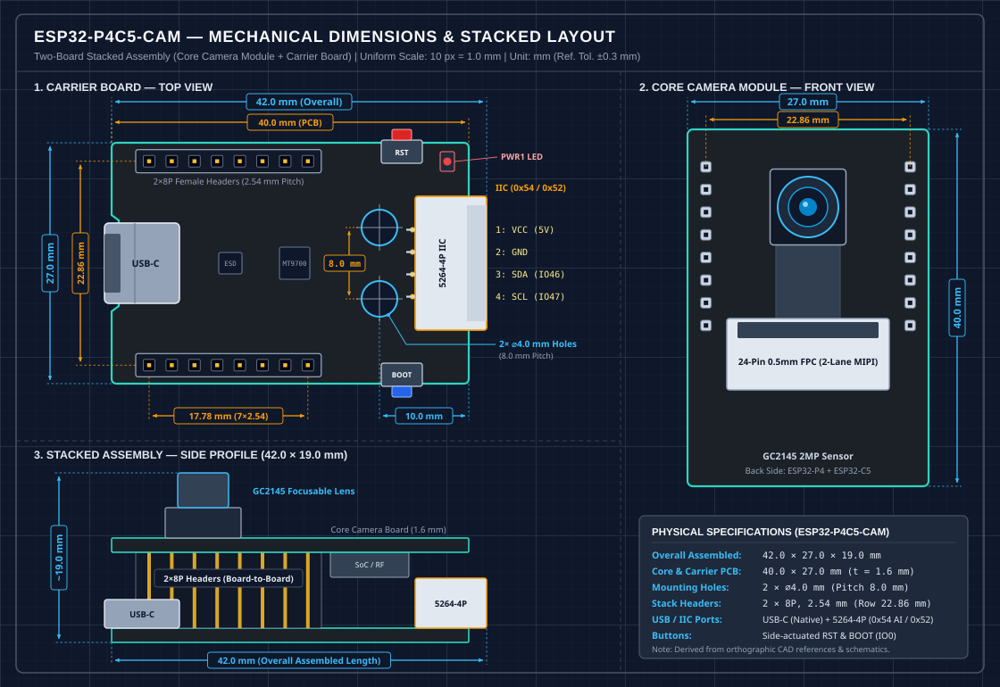

# Hardware Specifications & Schematics

**English** | [简体中文](#简体中文)

This directory contains official schematics and component datasheets for the **ESP32-P4C5-CAM** edge AI vision module.

---

## Documents & Schematics

| File | Description | Notes |
| :--- | :--- | :--- |
| [SCH_ESP32P4C5-CAM_Module_V1.0.pdf](SCH_ESP32P4C5-CAM_Module_V1.0.pdf) | Core Module Schematic | ESP32-P4 + ESP32-C5 (SDIO) + GC2145 MIPI-CSI |
| [SCH_ESP32P4C5-CAM_Carrier_Board.pdf](SCH_ESP32P4C5-CAM_Carrier_Board.pdf) | Carrier Board Schematic | USB-C, 5264-4P I²C, LDOs, RST / BOOT |
| [GC2145_Datasheet.pdf](GC2145_Datasheet.pdf) | Camera Sensor Datasheet | 2MP (1/5") 2-Lane MIPI-CSI image sensor |
| [esp32-p4_datasheet_cn.pdf](esp32-p4_datasheet_cn.pdf) | ESP32-P4 Datasheet | Dual-core RISC-V @ 400 MHz, Hardware ISP |
| [esp32-c5_datasheet_cn.pdf](esp32-c5_datasheet_cn.pdf) | ESP32-C5 Datasheet | Wi-Fi 6 (2.4/5 GHz) + BLE 5.0 co-processor |

For comprehensive hardware features and carrier board interface specifications, see [../docs/hardware_guide_en.md](../docs/hardware_guide_en.md).

---

## Power Requirements

> [!IMPORTANT]
> The module requires a stable **5V DC supply with at least 2A current capacity (`≥ 2A`)**.  
> Insufficient power or voltage drops can cause video ripple noise, camera sensor reset, or Wi-Fi brownout.

---

## Carrier Board Connector Pinout (`P1`)

The carrier board provides a keyed `5264-4P` (2.5mm pitch) connector for I²C host communication:

| Pin | Name | Electrical Level | Description |
| :---: | :---: | :---: | :--- |
| **1** | `VCC` | `5V (≥ 2A)` | System DC Power Input |
| **2** | `GND` | `0V` | Common Ground |
| **3** | `SDA` | `3.3V Logic` | I²C Data (`0x54` for offline vision, `0x52` for Wi-Fi streaming) |
| **4** | `SCL` | `3.3V Logic` | I²C Clock (`400 kHz` Fast Mode) |

---

## Mechanical Dimensions & Physical Specifications / 结构尺寸与物理规格

  

| Parameter / 规格参数 | Value / 数值 | Notes / 备注 |
| :--- | :--- | :--- |
| **Overall Assembled / 整机堆叠尺寸** | `42.0 mm × 27.0 mm × 19.0 mm` | Core + Carrier stacked (incl. IIC connector & lens) / 含底板、镜头与 IIC 端子 |
| **Core & Carrier PCB / 单板 PCB 尺寸** | `40.0 mm × 27.0 mm` | PCB thickness: `1.6 mm` / 双层板厚 `1.6 mm` |
| **Mounting Holes / 底板安装定位孔** | `2 × ⌀ 4.0 mm` | Vertical pitch `8.0 mm`, `10.0 mm` from right edge / 竖排双孔间距 `8.0 mm` |
| **Board-to-Board Headers / 板间排针排母** | `2 × 8P` (`2.54 mm` pitch) | Row-to-row spacing `22.86 mm` (`0.9"`) / 双排间距 `22.86 mm` |
| **I2C Connector / I2C 通讯端子** | `4-Pin 5264-4P` | `1: VCC (5V)`, `2: GND`, `3: SDA (IO46)`, `4: SCL (IO47)` |
| **USB Interface / USB 接口** | USB Type-C Receptacle | ESP32-P4 native USB (`D+/D-`) with ESD protection |
| **Operating Voltage / 工作电压** | `DC 5.0 V` | Recommended supply current `≥ 2.0 A` |
| **Operating Temperature / 工作温度** | `-20 °C ~ +70 °C` | Commercial industrial grade |

---

## 简体中文

本目录包含 **ESP32-P4C5-CAM** 视觉模组的核心硬件原理图、扩展底板原理图及核心元器件技术规格书。

### 原理图与资料清单

- **[SCH_ESP32P4C5-CAM_Module_V1.0.pdf](SCH_ESP32P4C5-CAM_Module_V1.0.pdf)**：ESP32P4C5-Cam 核心板原理图（ESP32-P4 主控、ESP32-C5 SDIO 协处理器、GC2145 2-Lane MIPI 接口、供电拓扑）。
- **[SCH_ESP32P4C5-CAM_Carrier_Board.pdf](SCH_ESP32P4C5-CAM_Carrier_Board.pdf)**：扩展底板原理图（Type-C 供电/调试、5264-4P I²C 通讯端子、RST/BOOT 物理按键）。
- **[GC2145_Datasheet.pdf](GC2145_Datasheet.pdf)**：GC2145 200 万像素 MIPI 摄像头传感器数据手册。
- **[esp32-p4_datasheet_cn.pdf](esp32-p4_datasheet_cn.pdf)**：乐鑫 ESP32-P4 RISC-V 400 MHz 主控芯片规格书。
- **[esp32-c5_datasheet_cn.pdf](esp32-c5_datasheet_cn.pdf)**：乐鑫 ESP32-C5 双频 Wi-Fi 6 / BLE 5.0 芯片规格书。

有关模块硬件接口电路与扩展底板功能说明，请参阅 [../docs/hardware_guide_zh.md](../docs/hardware_guide_zh.md)。

### 供电与电气要求

- **输入电源**：必须提供稳定 **5V DC 且电流容量 ≥ 2A** 的供电；若供电不足，在 Wi-Fi 6 发射与 ISP 高速运算时可能引起画面水纹或芯片重启。
- **I²C 逻辑电平**：总线信号线（SDA/SCL）为 **3.3V 逻辑电平**，请勿将 5V 逻辑直接接驳。
